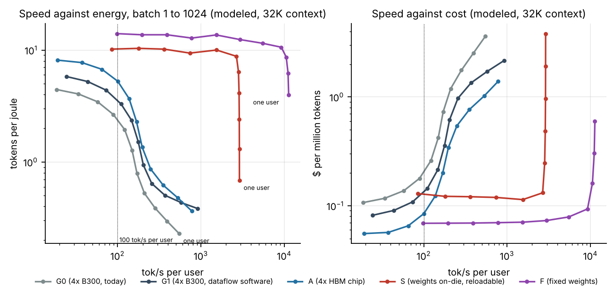

<!-- generated from docs/templates/README.md.j2 by experiments/render_docs.py; edit the template -->
# Inkling 2 Small on purpose-built silicon

A hardware-architecture study by Aercrist. It asks what a chip built around
[Inkling 2 Small](https://huggingface.co/thinkingmachines/Inkling-2-Small) (594B parameters, 17B
active per token) would deliver against the best published GPU deployment, which memory architecture
gets there, what keeping the weights reloadable costs, and how the answer changes for smaller models.
It is the sequel to our [DeepSeek-V4.1 study](https://github.com/Aercrist/dsv41-accel-study) and
follows its rules: every number is rendered from `results/*.json`, every constant is sourced or swept,
and the predictions were written down before anything was simulated.

This study is independent. It is not affiliated with or endorsed by Thinking Machines Lab.

**Nothing here was fabricated or measured on hardware by us.** The GPU figures reproduce other people's published
measurements; the chips are designs on paper; one circuit block was synthesized.

## Findings

Against B300 GPUs running today's best published engines, in the best layout for each metric (2x, 4x or
8x B300), for a chip that
keeps every weight in reloadable on-die memory. Median and range are over 400 joint draws of
30 uncertain inputs:

| | median | 5th to 95th percentile | central case | confidence |
|---|---|---|---|---|
| **speed for one user** | **3.4x** | 1.3x to 8.2x | 4.1x (3,000 against 720 tok/s) | medium: the GPU side is calibrated; the chip side takes its time per operation from a published machine |
| **tokens per joule**, decode, at each platform's best interactive point | **4.0x** | 2.0x to 8.2x | 4.4x | medium |
| **cost per token**, decode, at the same point | **1.00x** | 0.31x to 2.63x | 1.8x | low: rests on token demand, lifetime and margin |
| **what reloadable weights cost** against fixing them in the masks | | | 5.6x the silicon; speed not separable: the two designs' speeds come from two different published machines | medium on silicon: the fixed-weight side scales one shipped 8B chip |

1. **On-chip weights buy speed and energy, not cheap tokens.** One user gets about
   3,000 tokens a second instead of 720, and a busy system delivers 4.4x the
   tokens per joule. At 100 tok/s per user its decode cost is within 2x of the GPUs' either way (median 1.00x). From
   200 tok/s per user up, where GPUs hold only a handful of users each, it is
   4x cheaper, at batch sizes where our GPU model is least certain.
2. **The memory architecture is the lever, and software comes first.** Better software on the same
   GPUs is worth 1.7x for a single user. A purpose-built chip that still keeps its weights in HBM
   adds no speed on top of that (0.85x), but it is the cheapest whole system: 2.2x lower cost
   than GPUs with prefill counted.
3. **It can do its own prefill, if prompts are pipelined.** On the published agentic workload prefill is
   34% of what GPUs cost per output token. With 48 prompts in flight the on-chip design
   prefills at 0.94x the GPUs' cost per token; end to end it is 1.4x lower in cost and 3.3x
   better in tokens per joule than GPUs. Paired with HBM chips for prefill: 1.9x and 3.0x.
4. **Reloadable weights cost 5.6x the silicon.** In return: three die designs instead of
   95, and a new model version by loading weights instead of $56M of new masks. The
   synthesized block shows that fixing a multiplier's weight saves only 1.13x in that lane's area. The silicon
   difference is SRAM against mask-programmed storage, plus S's multiplier lanes (32% of its silicon);
   the fixed design's density comes from one shipped chip with its arithmetic folded in. The fixed design's higher speed in our tables is not separable: the two designs' speeds come from two different published machines, not a property of reloadability.
5. **It needs scale.** 521 dies, about $1.4M a system with its share of design cost.
   It breaks even with GPUs at about 1.6 trillion tokens a day of this one model.
6. **The gain narrows down the ladder for models shaped like this one.** We predicted the opposite.
   At about 8B parameters the speed gain is 2.8x. For dense models the published machines show
   it widening.

Our prior was a gain of about 2-10x. Speed and energy landed inside it; cost landed below it.
Two adversarial reviews changed these numbers substantially ([05](docs/05_limitations.md)): before
them the cost figure read 9.5x.

## Key results

| platform | one user: tok/s | tokens/J | $/M tokens | best interactive point: batch | tokens/J | $/M tokens |
|---|---|---|---|---|---|---|
| G0 · 4x B300, today's engines (calibrated) | 550 | 0.23 | $3.58 | 101 | 2.42 | $0.200 |
| G0 · 2x B300, today's engines (calibrated) | 380 | 0.26 | $2.63 | 14 | 0.72 | $0.712 |
| G1 · 4x B300, dataflow-style software (projected) | 930 | 0.39 | $2.13 | 153 | 3.58 | $0.132 |
| A · 4x MDA-1, HBM decode chip (proposed) | 790 | 0.37 | $1.37 | 128 | 5.27 | $0.085 |
| S · MDS-1, reloadable weights on-die (proposed) | 2,960 | 0.70 | $3.74 | 96 | 10.64 | $0.111 |
| F · MDF-1, fixed weights (comparison point) | 12,320 | 4.36 | $0.55 | 256 | 13.70 | $0.069 |

All modeled; the two G0 rows are calibrated to published speeds. Costs are decode only. One user: 8K
context, draft model on. Best interactive point: each platform's best batch at 32K context with at least
100 tok/s per user. N4P-class process, the node B300 is built on; N3-class
changes the gain by 1.28x in tokens per joule and
1.00x in speed.



**Where purpose-built silicon does not win**: decode cost at ordinary interactive speed (about
level); prefill (0.91x the GPUs per dollar); demand below about 1.6 trillion
tokens a day; small sparse models; very long context on cheap KV memory; a single request
(0.29x of a busy GPU cluster's tokens per joule).

## Method

1. **Workload from the checkpoint.** Parameter counts, precisions and bytes per token are computed
   from the safetensors headers and reproduce the published 594.05B exactly
   ([01](docs/01_workload.md)).
2. **A GPU baseline calibrated to public data.** Four constants fitted to 9 published
   figures from two serving engines, 8.0% RMS error, leave-one-out median
   12.9% and worst 64% ([06](docs/06_simulator.md)). The GPU gets its best
   published setup, its prefill load counted, and a software-only counterfactual on the same GPUs.
3. **A check on four real machines.** Llama 3.1 8B on a GPU, two SRAM machines and a fixed-weight
   chip, from public specifications: 0 of 4 within 30%. We report that as a
   failure and use the published speeds to set the chip's time per operation instead of our own
   assumption.
4. **Five platforms on one simulator**, with the same constants wherever the physics is the same
   ([02](docs/02_design_rationale.md), [03](docs/03_architecture.md)).
5. **One block in silicon.** The NVFP4 block-scaled dot product in SystemVerilog, checked bit for bit
   against a reference on real expert weights, synthesized on an open 7 nm kit
   ([07](docs/07_silicon.md)).
6. **Predictions first.** 36 numeric predictions frozen before simulation;
   21 of 35 scored landed inside their range, and the misses are listed
   ([00](docs/00_hypotheses.md)).
7. **Uncertainty.** 30 inputs with stated ranges, moved one at a time and all
   together (400 draws). A napkin calculation beside each headline ([napkin](docs/napkin.md)).
8. **Adversarial review.** Two fresh agents attacked a clean copy of the repo. Their findings, what
   we changed and how far the headline moved are in [05](docs/05_limitations.md).

## Read next

| page | what it is |
|---|---|
| [docs/04_results.md](docs/04_results.md) | every result, including where silicon does not win |
| [docs/00_hypotheses.md](docs/00_hypotheses.md) | the predictions and how they scored |
| [docs/01_workload.md](docs/01_workload.md) | the model from its checkpoint, and what the serving engine's source adds |
| [docs/02_design_rationale.md](docs/02_design_rationale.md) | the five platforms and why |
| [docs/03_architecture.md](docs/03_architecture.md) | the reloadable design and the fixed-weight comparison: area, power, cost |
| [docs/05_limitations.md](docs/05_limitations.md) | limits, what would change the conclusions, review log |
| [docs/06_simulator.md](docs/06_simulator.md) | the simulator, the calibration, the check it failed |
| [docs/07_silicon.md](docs/07_silicon.md) | the synthesized block |
| [docs/napkin.md](docs/napkin.md) | hand arithmetic for each headline |
| [docs/decisions.md](docs/decisions.md) · [docs/sources.md](docs/sources.md) | judgment calls; every source by key |
| [CLAIMS.md](CLAIMS.md) | each public claim mapped to the result behind it |

## Reproduce

```bash
pip install -r requirements.txt
```

```bash
make reproduce
```

```bash
make test
```

`make reproduce` regenerates every number, figure and document from the committed inputs and needs
no network. The checkpoint manifest (headers only, 1,854 tensors) is committed;
`tools/fetch_checkpoint_manifest.py` rebuilds it from the Hub. The circuit block's simulation and
synthesis need Icarus Verilog, Verilator, Yosys and, for place and route, the OpenROAD flow; see
[07](docs/07_silicon.md). Their results are committed, so `make reproduce` does not need them.

Edit `docs/templates/`, not the generated files.

## Layout

```
data/         model config, checkpoint manifest, published figures, frozen predictions, test fixtures
sim/          operation-level simulator: model builders, the HBM engine, the weight-stationary engine
configs/hw/   one file per platform; every constant has a source key or the word "assumption"
experiments/  calibration, experiments, uncertainty, predictions, napkin, doc rendering
rtl/          the NVFP4 dot-product block and the router block from the previous study
results/      generated JSON and figures
docs/         generated pages; templates/ holds what to edit
tests/        invariants
```

## Limitations

This is a model, not a measurement. The chip's speed rests on a time per operation inferred from
someone else's machine running a different model. Its cost rests on an assumed token demand, an
assumed attention engine and street prices for GPUs, and is costed without a seller's margin. No
layout was done; reliability of a 521-die system is not modeled; GPU software will keep
improving. [05](docs/05_limitations.md) has the full list and what would change the conclusions.

## Acknowledgments

Built on the public work of Thinking Machines Lab (Inkling 2 Small, its model card and announcement)
and of the vLLM, SGLang and TokenSpeed projects, whose published recipes, measurements and source make
a calibrated GPU baseline possible. The synthesis uses the ASAP7 predictive kit, Yosys and OpenROAD.
Errors are ours; corrections are welcome.

Ben Blaine, Aercrist.
