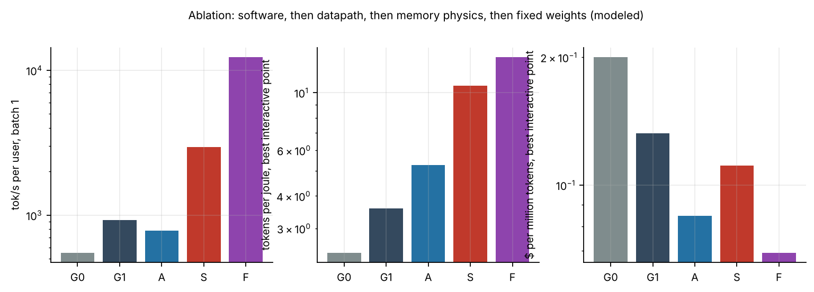
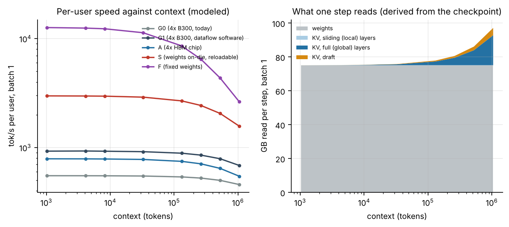

<!-- generated from docs/templates/04_results.md.j2 by experiments/render_docs.py; edit the template -->
# 04 · Results

Every number on this page is **modeled** unless it says measured. The GPU rows (G0) are calibrated to
published speeds ([06](06_simulator.md)); the other platforms are designs on paper, costed on the same
operation graph. Published figures are quoted with their source key ([sources](sources.md)).

Two operating points are used throughout, fixed before any simulation ([00](00_hypotheses.md)):

- **Batch 1**: one request, 8K context, text only, DSpark on, the NVFP4 checkpoint.
- **Best interactive point**: each platform at its own best batch, subject to at least
  100 tok/s per user, at 32K context.

The lead GPU baseline is **the best B300 deployment for each metric**: 2x, 4x or 8x B300 (an HGX
node), whichever does best on that metric. For one user that is 8x B300; at the best interactive
point it is 4x B300. Results against 2x B300 alone (the smallest deployment the model card
allows) are larger and are given in section 13.

## 1 · Headline

| platform | batch 1: tok/s per user | tokens/J | $/M tokens | best tokens/J (batch, tok/s per user) | best $/M tokens (batch, tok/s per user) |
|---|---|---|---|---|---|
| G0 · 4x B300, today's engines (calibrated) | 550 | 0.23 | $3.58 | 2.42 (101, 100) | $0.200 (101, 100) |
| G0 · 8x B300, today's engines (calibrated) | 720 | 0.17 | $5.45 | 1.86 (150, 100) | $0.269 (150, 100) |
| G0 · 2x B300, today's engines (calibrated) | 380 | 0.26 | $2.63 | 0.72 (14, 101) | $0.712 (14, 101) |
| G1 · 4x B300, dataflow-style software (projected) | 930 | 0.39 | $2.13 | 3.58 (153, 100) | $0.132 (153, 100) |
| A · 4x MDA-1, HBM decode chip (proposed) | 790 | 0.37 | $1.37 | 5.27 (128, 100) | $0.085 (128, 100) |
| S · MDS-1, reloadable weights on-die (proposed) | 2,960 | 0.70 | $3.74 | 10.64 (96, 1,052) | $0.111 (96, 1,052) |
| F · MDF-1, fixed weights (comparison point) | 12,320 | 4.36 | $0.55 | 13.70 (256, 390) | $0.069 (256, 390) |

Cost is for owned hardware over 4 years, fully used, with electricity at
$0.0862/kWh and a PUE of 1.25; chips include their share of
design cost (NRE). Section 12 varies all of it.

Against G0, each metric against the best B300 layout for it (G1, the software counterfactual, against 4x B300):

| | speed, batch 1 | tokens/J, batch 1 | tokens/J, best point | cost per token, best point |
|---|---|---|---|---|
| G1 · same 4x B300, dataflow software | 1.7x | 1.7x | 1.5x | 1.5x |
| A · decode chip on HBM | 1.1x | 1.4x | 2.2x | 2.4x |
| **S · reloadable weights on the chip** | **4.1x** | **2.7x** | **4.4x** | **1.8x** |
| F · fixed weights (comparison point) | 17.1x | 16.7x | 5.7x | 2.9x |

With every uncertain input varied together (400 draws, section 12), S against the best B300 layout for each metric:

| | 5th percentile | median | 95th percentile | share of draws above 1x |
|---|---|---|---|---|
| speed, batch 1 | 1.3x | 3.4x | 8.2x | 100% |
| tokens/J, batch 1 | 0.4x | 1.7x | 5.9x | 74% |
| tokens/J, best point | 2.0x | 4.0x | 8.2x | 100% |
| cost per token, best point | 0.3x | 1.0x | 2.6x | 50% |

**How to read this.**

- **Lead with the medians.** The central case is one setting of 30 uncertain inputs. The medians
  of the joint draws are 3.4x in speed, 4.0x in tokens per joule and
  1.0x in cost.
- **Speed and energy are the result. Cost is not.** At 100 tok/s per user and
  5 trillion tokens a day, S's decode cost is about level with the GPUs', and the simpler
  HBM chip (A) is cheaper than both (2.4x). S's cost case depends on demand (section 18), on how fast
  "interactive" has to be (section 17) and on the size of its attention tile (section 19).
- **These cost figures are decode only.** With prefill counted on the published agentic workload the
  picture changes again (section 16).
- **Against the best published number.** The modeled GPU baseline for one user (8x B300) is 720 tok/s. The best
  published single-user figure on any GPU layout is 630 tok/s on 4x GB200 (measured; vllm-blog);
  against that, S is 4.7x.
- **Our prior** was a gain of about 2-10x for a model this size. Speed and energy are inside it; cost is below it.
- **Before the adversarial reviews** ([05](05_limitations.md)) the same row read 7.4x in speed,
  6.7x in tokens per joule and 9.5x in cost.

## 2 · Where the gain comes from

Each step changes one thing.

| step | lever | tok/s per user, batch 1 | speed against the step before | tokens/J at best point, against G0 | cost at best point, against G0 |
|---|---|---|---|---|---|
| today's engines on 4x B300 | baseline | 550 | 1.00x | 1.0x | 1.0x |
| + dataflow-style software on the same GPUs | software | 930 | 1.68x | 1.5x | 1.5x |
| + a decode chip on the same HBM (A) | datapath | 790 | 0.85x | 2.2x | 2.4x |
| + weights moved on-die into SRAM (S) | memory physics | 2,960 | 3.77x | 4.4x | 1.8x |
| + weights fixed in the masks (F) | reloadability given up | 12,320 | 4.16x | 5.7x | 2.9x |

- **Software alone is worth 1.7x at batch 1.** A single request on today's engines
  spends 49% of each step waiting on
  kernel launches (section 3). The same GPUs with a compiled dataflow schedule recover most of that.
  This is the software counterfactual, and silicon is measured against it too.
- **A chip on the same HBM is no faster than that software at batch 1
  (0.85x).** Both are bound by reading weights out of HBM, and the
  chip is charged the same per-operation latency as S. Its gain is in tokens per joule and cost at
  high batch (2.2x and 2.4x), because it draws far less
  power and costs less than a GPU for the same memory.
- **Moving the weights onto the chip is the large step: 3.8x.**
  Nothing is streamed; each weight sits next to its multiplier.
- **Fixing the weights in the masks adds 4.2x more**, at the
  price of a new mask set for every model version (section 7).

A newer process is not where the gain comes from. Moving S from N4P-class to N3-class changes speed by
1.00x, tokens per joule by 1.28x
and cost by 1.13x (N3-class: SRAM 1.1x denser, logic 1.6x denser, 30% less energy, wafer $20,000 (unverified factors)). The
B300 is built on TSMC 4NP, so N4P-class is the like-for-like comparison and is the one reported.

## 3 · Where the time and the energy go at batch 1

Time per decode step (a step emits 3.5 tokens on average):

| platform | step | kernel launches and waits | memory | arithmetic | collectives and hops |
|---|---|---|---|---|---|
| G0 · 8x B300 | 4.85 ms | 2.40 ms | 2.08 ms | 0.04 ms | 0.34 ms |
| A · 4 packages | 4.46 ms | 1.12 ms | 2.40 ms | 0.60 ms | 0.33 ms |

| platform | step | weight operations (bank passes and per-operation time) | attention: KV fetch | attention: arithmetic | hops between tiles | fixed |
|---|---|---|---|---|---|---|
| S | 1.181 ms | 1.096 ms | 0.025 ms | 0.026 ms | 0.016 ms | 0.019 ms |

On the GPU a single request is bound by launches and by streaming weights, not by arithmetic
(0.9% of the step). TokenSpeed's own
description agrees: "single-user decode is bound by kernel launches and dependency waits rather than
math" (measured; tokenspeed-blog).

Energy per token at batch 1:

| S, joules per token | |
|---|---|
| reading weight banks | 0.038 |
| arithmetic | 0.011 |
| KV memory, active | 0.0018 |
| logic and clock, static | 0.703 |
| links, idle | 0.284 |
| SRAM leakage (idle banks in retention) | 0.022 |
| KV memory and host, static | 0.195 |
| power delivery loss | 0.171 |
| **total** | **1.428** (0.70 tokens/J) |

The GPU spends 5.94 J per token at
batch 1 (5.25 J in the GPUs, 0.69 J
in the host). At batch 1, S is dominated by static power: a machine of 521 dies
serving one request. That is why power management decides the batch-1 energy result (section 8).

## 4 · The frontier: speed per user against throughput

32K context, speculation on.

| batch | G0 · 4x B300: tok/s per user | total tok/s | A · 4 packages: per user | total | S: per user | total | F: per user | total |
|---|---|---|---|---|---|---|---|---|
| 1 | 548 | 500 | 778 | 800 | 2,903 | 2,900 | 11,332 | 11,300 |
| 8 | 210 | 1,700 | 249 | 2,000 | 2,875 | 23,000 | 9,242 | 73,900 |
| 64 | 122 | 7,800 | 138 | 8,800 | 1,544 | 98,800 | 1,529 | 97,900 |
| 256 | 58 | 14,800 | 65 | 16,600 | 362 | 92,800 | 390 | 99,800 |
| 1024 | 19 | 19,000 | 19 | 19,600 | 85 | 86,700 | 98 | 100,200 |

Three things to read from it.

1. **The GPU's weak spot is the interactive point, not peak throughput.** Once more than a few dozen
   requests are in flight, every step touches every expert, so every step streams the whole
   393 GB checkpoint through HBM. That sets a floor on the step
   time, and a floor on step time is a ceiling on speed per user. At 100
   tok/s per user the GPUs stop at batch 101.
2. **The model agrees with the published throughput once prefill is counted.** With nothing else on the
   GPUs, G0 gives 2,530 output tok/s per GPU at that point. vLLM publishes about
   1,070 per GPU on GB200 at the same 32K and 100 tok/s per user (measured; vllm-blog), with every
   session also prefilling about 3K new tokens a turn on the same GPUs. The fit includes that prefill
   ([06](06_simulator.md)).
3. **S and F run into attention, not weights.** Their total throughput flattens near
   87,000 tok/s because every request's full-attention layers share one attention
   tile. Past that point more weight silicon buys nothing; more attention silicon would. At high batch
   S and F deliver nearly the same throughput for that reason.

## 5 · Long context

One request, speculation on.

| context | G0 · 4x B300 | A · 4 packages | S | F | S / A |
|---|---|---|---|---|---|
| 1,024 | 551 | 788 | 2,982 | 12,639 | 3.8x |
| 4,096 | 551 | 787 | 2,974 | 12,500 | 3.8x |
| 8,192 | 550 | 785 | 2,963 | 12,319 | 3.8x |
| 32,768 | 548 | 778 | 2,903 | 11,332 | 3.7x |
| 131,072 | 537 | 747 | 2,682 | 8,583 | 3.6x |
| 262,144 | 524 | 709 | 2,436 | 6,486 | 3.4x |
| 524,288 | 500 | 644 | 2,058 | 4,356 | 3.2x |
| 1,048,576 | 457 | 545 | 1,571 | 2,630 | 2.9x |

The designs converge as context grows: S is 3.8x faster than A at 8K and
2.9x at 1M tokens. At 1M tokens a step reads
22 GB of KV cache
(23% of all bytes a GPU step moves), and that traffic is the
same on every platform. A chip with its weights on-die still needs fast KV memory. With the KV cache
in LPDDR instead of HBM (a pool of 1.09 TB/s against
26 TB/s; pool size is an assumption), S falls behind A
above about 146,000 tokens of context and behind the GPUs above
about 226,000.

The published GPU figures fall with context too: vLLM's throughput per GPU drops from about
1,070 at 32K to about 450 at 256K
(measured; vllm-blog).

## 6 · Prefill

Prefill over 3,072 new tokens on top of a cached 32,768-token prefix, each platform at the
number of prompts in flight that makes its prefill cheapest (1, 4, 16 or 48 tried). A pipelined design
like S needs several prompts in flight to use all its layers; with one prompt, all but one of its
66 tiles sit idle.

| platform | prompts in flight | one prompt alone | prefill tok/s | $/M prefill tokens | one prompt alone: $/M |
|---|---|---|---|---|---|
| G0 · 4x B300, today's engines (calibrated) | 16 | 67 ms | 59,700 | $0.0336 | $0.0427 |
| G0 · 8x B300, today's engines (calibrated) | 16 | 49 ms | 75,400 | $0.0530 | $0.0632 |
| G1 · 4x B300, dataflow-style software (projected) | 4 | 50 ms | 79,900 | $0.0249 | $0.0319 |
| A · 4x MDA-1, HBM decode chip (proposed) | 48 | 52 ms | 65,200 | $0.0166 | $0.0184 |
| S · MDS-1, reloadable weights on-die (proposed) | 48 | 71 ms | 313,100 | $0.0358 | $0.2573 |
| F · MDF-1, fixed weights (comparison point) | 48 | 52 ms | 315,100 | $0.0219 | $0.1141 |

Prefill is where S's gain is smallest: at its best concurrency it prefills at 0.94x the GPUs' cost per
token. The HBM chip is the cheapest at prefill (2.0x the GPUs). Prefill is many tokens in parallel,
which GPUs and HBM chips handle well. On the agentic workload the engines publish
(3 new prompt tokens per output token after cache hits), GPU prefill adds about
$0.10 per million output tokens. Our first version ran S's prefill one prompt at a time and
concluded it should not prefill at all; the second review corrected that ([05](05_limitations.md)).

## 7 · What reloadable weights cost: S against F

| | S · reloadable | F · fixed | S / F |
|---|---|---|---|
| dies (800 mm² each) | 521 | 93 | 5.60x |
| manufacturing cost per system | $869,000 | $197,000 | 4.41x |
| tok/s per user, batch 1 | 2,960 | 12,320 | 0.24x |
| tokens/J, batch 1 | 0.70 | 4.36 | 0.16x |
| tokens/J, best point | 10.64 | 13.70 | 0.78x |
| $/M tokens, best point | $0.111 | $0.069 | 1.61x |
| distinct die designs | 3 | 95 | |
| masks to change for a new model version | none: load new weights | $55.8M of unique mask layers | |

Reloadability costs 5.6x the silicon and 1.6x in decode cost per token.
At a busy operating point it costs 1.29x in tokens per joule.

**The speed difference in the table is not a cost of reloadability.** S takes its time per weight
operation from a published wafer-scale SRAM machine; F takes its from a published fixed-weight chip. The
synthesized fixed-weight datapath closes timing at the same clock as the reloadable one (its best period
is slightly slower), so on S's own clock and latency F would be no faster. The 4.2x is a difference
between two vendors' machines.

What it buys: one die design instead of 95, and a new model
version, a fine-tune or a different model of the same family by loading weights, not by taping out.
The fixed design here also assumes that a published single-die result at 8B parameters (measured;
taalas-hc1) carries to a model 74x larger on 93 dies; the only public figure
for a model of this class on that approach is the vendor's own simulation, not a measurement.
[07](07_silicon.md) gives the synthesized datapath behind the area and energy ratio.

## 8 · Power management decides the batch-1 energy result

S holds 393 GB of weights and a single token touches
4.9% of them.

| S at batch 1 | system power | tokens/J | against G0 at batch 1 | against G0 at its best batch |
|---|---|---|---|---|
| idle banks in retention, idle lanes clock-gated | 4,230 W | 0.70 | 2.7x | 0.29x |
| everything at full voltage, clocks running | 9,200 W | 0.32 | 1.2x | 0.13x |

Serving one request, S draws kilowatts to keep 521 dies ready. With power management it
reaches 0.29x of the tokens per joule of a GPU cluster running at its best batch,
while serving that request 4.1x faster; without it, 0.13x.
The efficient way to run S is busy (section 4).
The managed figure assumes a 10 ns
wake from retention (assumption); SRAM leakage at operating temperature has no public source at this node and is
swept over a 20x range (section 12).

## 9 · Down the ladder

Thinking Machines describes Inkling 2 Small as "part of a ladder of models" (tml-news). No smaller
rung is public, so the middle rungs here are **hypothetical**: Inkling 2 Small's architecture and
ratios, scaled down. Each rung is compared against the best published GPU setup for its size.

| rung | parameters | GPUs | G0 tok/s per user | S dies | S tok/s per user | S speed | S tokens/J, best | S cost, best | A speed | F speed |
|---|---|---|---|---|---|---|---|---|---|---|
| Inkling 2 Small | 594.1B | 4 | 720 | 521 | 2,960 | 4.1x | 4.4x | 1.8x | 1.1x | 17.1x |
| Inkling-2-shaped, ~100B (hypothetical) | 93.5B | 1 | 1,160 | 97 | 4,650 | 4.0x | 3.1x | 0.6x | 1.2x | 18.2x |
| Inkling-2-shaped, ~30B (hypothetical) | 33.6B | 1 | 1,720 | 43 | 5,660 | 3.3x | 3.0x | 0.4x | 1.6x | 15.3x |
| Inkling-2-shaped, ~8B (hypothetical) | 8.6B | 1 | 2,070 | 20 | 5,720 | 2.8x | 3.3x | 0.3x | 2.3x | 13.4x |

**This ran against our hypothesis.** We predicted the gain would grow as the model shrinks (H4). For
Inkling-shaped rungs it shrinks: 4.1x at 594B down to
2.8x at about 8B. The reason is the architecture. A sparse
mixture-of-experts model with a draft model reads a small fraction of its weights per token, so a
small rung leaves a GPU with very little to stream, and the GPU gets fast: G0 goes from
720 to
2,070 tok/s per user. S gets faster too, but it
is already near its per-operation floor.

Cost runs the same way, more sharply. At the central demand, design cost alone is
$0.041 per million tokens. A small model on GPUs already costs about that much to serve, so for the
smaller rungs S's cost gain falls below 1 (0.34x at about 8B).

For a **dense** model the published record points the other way. Llama 3.1 8B is the one model with
published speeds on four memory architectures (measured by others; conditions differ, see [06](06_simulator.md)):

| platform | published tok/s | against the GPU | source |
|---|---|---|---|
| NVIDIA H200, one GPU (HBM) | 235 | 1.0x | nim-bench (vendor) |
| Cerebras WSE-3 (SRAM, one wafer) | 1,981 | 8.4x | taalas-chart (relayed) |
| Groq LPU (SRAM, many chips) | 594 | 2.5x | taalas-chart (relayed) |
| Taalas HC1 (fixed weights, one die) | 16,960 | 72.2x | taalas-chart (vendor) |

A dense model reads every weight for every token, so the GPU has no sparsity to hide behind. The
ladder answer therefore depends on what the small rungs look like: for sparse, speculative models like
this one the gain narrows; for dense ones the published machines show it widening.

## 10 · Routing skew

No routing traces for Inkling 2 Small are public, so expert popularity is swept across the range
measured on four open mixture-of-experts models (sources: routing-skew).

| case | weights read per GPU step | G0 tok/s per user | S tok/s per user | S / G0 speed | S / G0 tokens/J, best |
|---|---|---|---|---|---|
| uniform, independent rows | 75.3 GB | 550 | 2,960 | 4.1x | 4.4x |
| measured-mild: top 20% of experts get 47% | 71.5 GB | 570 | 2,960 | 4.0x | 4.5x |
| measured-mild plus neighbouring-token locality 0.3 | 58.7 GB | 620 | 2,960 | 3.8x | 4.5x |
| measured-strong: top 20% get 80% | 54.0 GB | 650 | 2,960 | 3.7x | 4.3x |
| measured-strong plus locality 0.3 | 46.6 GB | 690 | 2,780 | 3.3x | 4.2x |

Skew and locality help the GPU (fewer distinct experts to stream per step) and leave S unchanged at
batch 1. The headline uses uniform routing with no locality, the case least favourable to the GPU; the
last row is the case most favourable to it.

## 11 · Fine-tunes: many LoRA adapters on one base model

Thinking Machines' fine-tuning service trains LoRA adapters; the recipes serve attention-only adapters
on the quantized checkpoint (vllm-recipe). At rank 32:

| adapter covers | parameters | bytes | share of the model | SRAM on S | adapters per die |
|---|---|---|---|---|---|
| attention only | 75.1M | 150 MB | 0.013% | 72 mm² | 9.5 |
| attention and output head | 81.7M | 163 MB | 0.014% | 78 mm² | 8.7 |
| attention, output head and experts | 4,179.8M | 8,360 MB | 0.704% | 3,986 mm² | 0.2 |

An attention-only adapter is 150 MB. One hundred of them
resident at once add about 11 dies to S's
521. On a fixed-weight design the base model is in the masks, so adapters need a
reloadable side memory in any case. Adapters that also cover the experts are
8.4 GB each and are not
servable on the quantized checkpoint today.

## 12 · Uncertainty

30 inputs each have a low and a high value with a reason ([06](06_simulator.md)).
The tornado moves one at a time; the Monte Carlo draws all together.

Largest single movers of S against the GPUs:

| headline | central | moved most by |
|---|---|---|
| speed, batch 1 | 4.1x | S per-operation latency; GPU HBM efficiency; S hop between tiles |
| tokens/J, batch 1 | 2.7x | S per-operation latency; S logic static power per die; S idle link power per tile |
| tokens/J, best point | 4.4x | S logic static power per die; S SRAM read energy; S KV memory bandwidth |
| cost per token, best point | 1.8x | fleet demand (tokens per day); S lifetime (years); S KV memory bandwidth |

- **Speed rests on the time per weight operation.** We did not invent it: S takes the whole time per
  operation that a published wafer-scale SRAM machine shows on Llama 3.1 8B (3.91 µs;
  [06](06_simulator.md)). With a published many-chip SRAM system's (13.1 µs) the speed gain is
  1.4x; with only half again S's own bank pass (1.2 µs) it is 10.4x.
- **Cost rests on demand.** At 0.5 trillion tokens a day the cost gain is 0.42x; at
  20 trillion it is 2.47x.

The cost gain is above 1 in 50% of draws. The speed gain is above 10x in
0% of them.

## 13 · Against the smallest GPU deployment

The model card's minimum is 2x B300. It is slower per user and has a weak interactive point (it reaches
100 tok/s per user only up to batch 14), so ratios
against it are larger. We report them for completeness and do not lead with them.

| S against G0 on | speed, batch 1 | tokens/J, batch 1 | tokens/J, best point | cost per token, best point |
|---|---|---|---|---|
| best B300 layout per metric (lead) | 4.1x | 2.7x | 4.4x | 1.8x |
| 2x B300 | 7.8x | 2.7x | 14.7x | 6.4x |

## 14 · Where purpose-built silicon does not win

- **Cost at ordinary interactive speed**: at 100 tok/s per user S's decode cost gain is 1.8x
  centrally and 1.00x at the median; with a seller's margin of 50% it is 0.91x (section 19).
- **Prefill**: at its best concurrency S prefills at 0.94x the GPUs' cost per token, and the HBM chip at
  2.0x (section 6).
- **Low demand**: below about 1.6 trillion tokens a day S does not pay back its design cost (section 18).
- **Small models**: the speed gain narrows to 2.8x at about 8B and the cost gain falls below 1 (section 9).
- **Long context**: the lead over an HBM chip shrinks from 3.8x to 2.9x, and with cheap KV
  memory S loses outright above about 146,000 tokens (section 5).
- **A single request**: 0.29x of a busy GPU cluster's tokens per joule even with power
  management, 0.13x without (section 8).
- **Software**: 1.7x of the batch-1 speed gain is available on the GPUs already installed (section 2).
- **Anything this study did not model**: vision input, reasoning-length variation, failures, and the
  years it takes to build a chip ([05](05_limitations.md)).

## 15 · Predictions against results

21 of 35 scored predictions landed inside their pre-registered range. The
full table is in [00](00_hypotheses.md). The misses that matter:

- **P04** A / G1 per-user speed at equal HBM bandwidth, batch 1: predicted 1 (0.9 to 1.15), observed 0.848. (four packages against four GPUs)
- **P05** A / G1 tokens per joule, batch 1: predicted 1.7 (1.2 to 2.5), observed 0.952. (four packages against four GPUs)
- **P07** S: number of reticle-class dies holding every weight in SRAM, N4P-class, checkpoint precision: predicted 250 (160 to 330), observed 521.
- **P15** Synthesis: reloadable / fixed-weight cell area of the dot-product datapath (logic only, same function): predicted 1.8 (1.3 to 3), observed 1.13. (ASAP7, placed and routed; a lane whose weight never changes. With a row's weights time-shared through one lane the fixed variant is larger)
- **P16** Synthesis: reloadable / fixed-weight dynamic energy per dot product: predicted 2 (1.3 to 3.5), observed 1.12. (same designs, gate-level activity on real tensors)
- **P20** Ladder, S / best GPU per-user speed at batch 1, at 594B: predicted 12 (5 to 24), observed 4.11. (best GPU layout at batch 1: 8x B300)
- **P21** Ladder, S / best GPU per-user speed at batch 1, hypothetical ~100B rung: predicted 15 (7 to 30), observed 4.
- **P22** Ladder, S / best GPU per-user speed at batch 1, hypothetical ~30B rung: predicted 25 (10 to 50), observed 3.29.
- **P23** Ladder, S / best GPU per-user speed at batch 1, hypothetical ~8B rung: predicted 40 (15 to 80), observed 2.77.
- **P24** Ladder: largest rung at which S fits on 8 dies or fewer: predicted 16 (8 to 30), observed 0. (Inkling-shaped rungs only)
- **P26** S / A per-user speed at 8K context, batch 1: predicted 8 (4 to 15), observed 3.77.
- **P29** G0 per-user speed at 1M context / at 8K context: predicted 0.3 (0.15 to 0.5), observed 0.781. (on 4x B300: 0.83)
- **P32** Llama 3.1 8B on four architectures: how many of the four published speeds the simulator reproduces within 30% on the first pass: predicted 2 (1 to 3), observed 0.
- **P34** Largest change in any headline ratio caused by the two adversarial reviews: predicted 1.5 (1.2 to 3), observed 5.27. (after both reviews)

## 16 · End to end: decode and prefill together

The published agentic workload has about 3 new prompt tokens for every output token, after cache hits
(vllm-blog). Each platform's decode cost at its best interactive point, plus the prefill those output
tokens need, at full use:

| | decode, $/M output | prefill, $/M output | **total** | prefill's share | cost against G0 | tokens/J against G0 |
|---|---|---|---|---|---|---|
| G0 · best B300 layout for each metric, today's engines (calibrated) | $0.200 | $0.101 | **$0.301** | 34% | 1.00x | 1.00x |
| G1 · 4x B300, dataflow-style software (projected) | $0.132 | $0.075 | **$0.207** | 36% | 1.45x | 1.51x |
| A · 4x MDA-1, HBM decode chip (proposed) | $0.085 | $0.050 | **$0.134** | 37% | 2.24x | 2.01x |
| S · MDS-1, reloadable weights on-die (proposed) | $0.111 | $0.107 | **$0.219** | 49% | 1.38x | 3.28x |
| F · MDF-1, fixed weights (comparison point) | $0.069 | $0.066 | **$0.135** | 49% | 2.23x | 4.23x |
| S · MDS-1 for decode, G0 · best B300 layout for each metric for prefill | $0.111 | $0.101 | **$0.212** | 48% | 1.42x | 2.19x |
| S · MDS-1 for decode, A · 4x MDA-1 for prefill | $0.111 | $0.050 | **$0.161** | 31% | 1.87x | 3.00x |

- **S can do its own prefill.** At 48 prompts in flight it is 1.38x lower in cost and 3.28x better in
  tokens per joule than GPUs end to end.
- **The HBM chip is the cheapest whole system**: 2.24x lower cost than GPUs end to end.
- **S for decode with HBM chips for prefill** is 1.87x lower in cost and 3.00x better in tokens
  per joule than GPUs, and gives each user 1,050 tok/s where the others give 100.

Prefill-heavy workloads are where on-chip weights help least; pairing S with HBM chips for prefill
is somewhat cheaper than S alone.

## 17 · How fast is "interactive"?

The headline uses 100 tok/s per user, vLLM's convention. That threshold never binds S, which
serves every user several times faster than that at any batch it can hold, and always binds the GPUs.
The gain therefore depends on where the threshold is put:

| every user gets at least | GPUs: best layout for cost, batch | A: tokens/J, cost | S: tokens/J, cost | F: tokens/J, cost |
|---|---|---|---|---|
| 25 tok/s | 4x B300, 578 | 1.9x, 2.0x | 2.6x, 1.0x | 3.3x, 1.7x |
| 50 tok/s | 4x B300, 311 | 2.0x, 2.2x | 2.9x, 1.2x | 3.8x, 1.9x |
| 100 tok/s | 4x B300, 101 | 2.2x, 2.4x | 4.4x, 1.8x | 5.7x, 2.9x |
| 150 tok/s | 8x B300, 78 | 2.0x, 2.3x | 7.0x, 3.1x | 8.9x, 4.9x |
| 200 tok/s | 8x B300, 42 | 1.0x, 1.3x | 9.1x, 4.3x | 11.7x, 6.9x |

At 25 to 100 tok/s per user S's decode cost is within a factor of two of the GPUs'. As the threshold
rises the GPUs hold fewer users each, move to eight GPUs, and S's cost advantage grows to
4.3x at 200 tok/s per user. **S is a chip for fast tokens at scale, not for cheap tokens at
ordinary speed.** One caution: the GPU model is least constrained at small batches, which is where the
GPUs sit at the higher thresholds. A published figure of 325 tok/s per user at eight concurrent
sessions on 4x B300 (measured; tokenspeed-blog) is consistent with the model only if fewer than eight were
decoding at once, so the GPUs may do somewhat better at the top of this table than it says.

## 18 · Demand and break-even

Design cost is spread over the systems a token demand needs, the same demand for every chip. The
central case is 5 trillion tokens a day of this one model (assumption).

| tokens a day | B300s that demand would need | A: cost gain | S: cost gain (systems) | F: cost gain |
|---|---|---|---|---|
| 0.25 trillion | 1,100 | 0.23x | 0.23x (31) | 0.19x |
| 0.50 trillion | 2,300 | 0.44x | 0.42x (62) | 0.38x |
| 1.00 trillion | 4,600 | 0.80x | 0.74x (125) | 0.73x |
| 2.00 trillion | 9,100 | 1.37x | 1.17x (250) | 1.37x |
| 5.00 trillion | 22,900 | 2.36x | 1.80x (624) | 2.89x |
| 10.00 trillion | 45,700 | 3.12x | 2.20x (1,248) | 4.59x |
| 20.00 trillion | 91,400 | 3.71x | 2.47x (2,496) | 6.51x |
| 50.00 trillion | 228,500 | 4.19x | 2.67x (6,239) | 8.70x |

Break-even with the GPUs' decode cost: about 1.3 trillion tokens a day for A,
1.6 trillion for S and 1.4 trillion for F. At the central demand a
$300M design cost is $0.041 per million tokens, against $0.20 for GPU decode. Below
about a trillion tokens a day no custom chip for a single model pays for itself on cost.

## 19 · The attention tile, and a seller's margin

**The attention tile sets S's cost.** Its 26 HBM stacks and pooled engine are about 1% of
the system's cost and cap its throughput; the 521 dies of weights could serve many times more.
The central design's tile was sized by assumption before any of this was known. Scaling the tile
(HBM stacks, engine and the sessions' window cache together):

| attention tile | HBM stacks | dies | sessions held | best batch | system tok/s | tokens/J against G0 | cost against G0 |
|---|---|---|---|---|---|---|---|
| 1x | 26 | 521 | 256 | 96 | 101,000 | 4.4x | 1.8x |
| 2x | 52 | 538 | 512 | 128 | 200,000 | 5.3x | 2.7x |
| 4x | 104 | 574 | 1024 | 256 | 396,000 | 6.2x | 3.6x |
| 8x | 208 | 645 | 2048 | 2048 | 730,000 | 7.1x | 3.4x |

A tile eight times larger roughly doubles the cost gain. We report the central design as it was
specified and did not re-tune it after the reviews; a balanced design would have a larger tile. One
system would then serve thousands of sessions, and its availability would matter more than this
study models.

**Margin.** The chips are costed to their owner (manufacturing plus design cost), as in our previous
study; GPUs are at street price, which includes the seller's margin. If S were sold:

| seller's gross margin | system price | decode cost against G0 |
|---|---|---|
| 0% | $1,380,000 | 1.80x |
| 30% | $1,970,000 | 1.27x |
| 50% | $2,760,000 | 0.91x |
