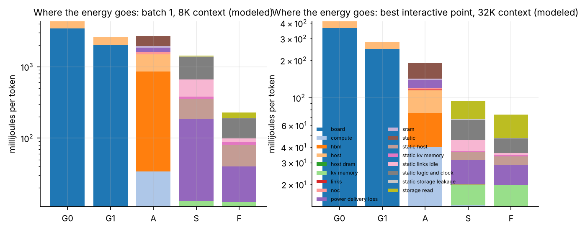
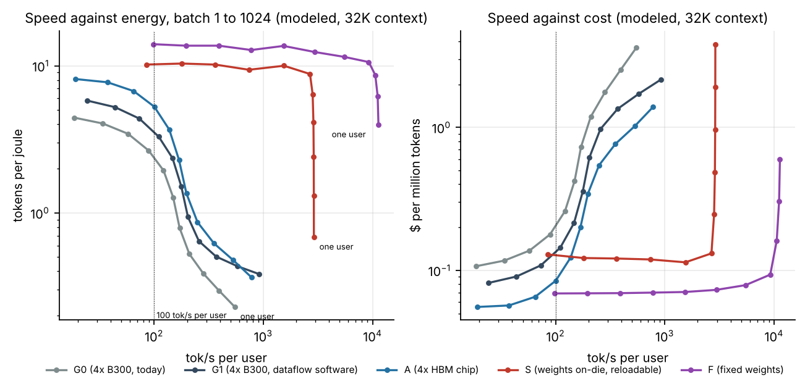
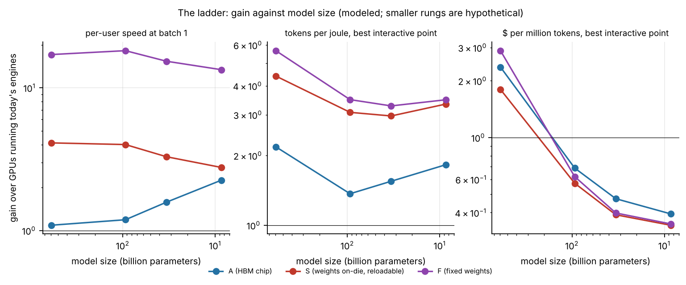
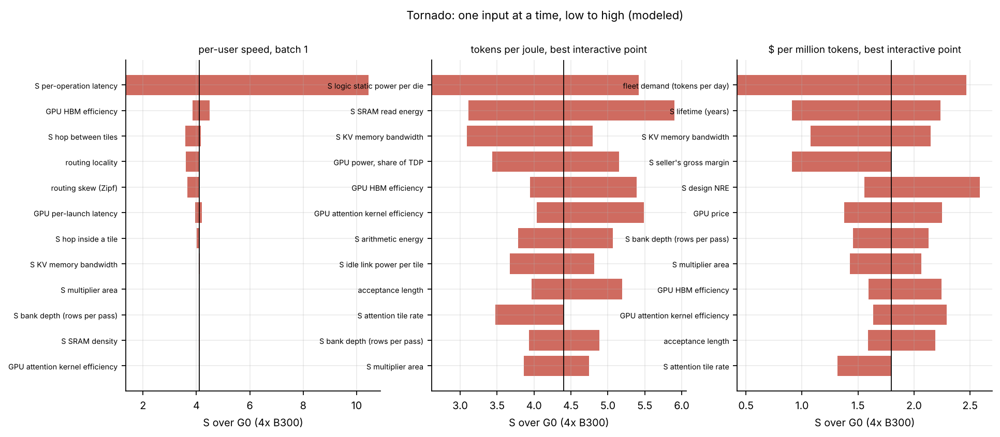
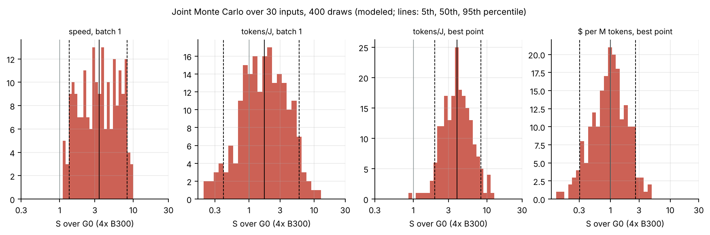

<!-- generated from docs/templates/04_results.md.j2 by experiments/render_docs.py; edit the template -->
# 04 · Results

Each number on this page is **modeled** unless the text says measured. We calibrated the GPU rows (G0) to
published speeds ([06](06_simulator.md)). The other platforms are designs on paper. The model calculates
their cost on the same operation graph. We give each published figure with its source key ([sources](sources.md)).

This page uses two operating points. We fixed them before any simulation ([00](00_hypotheses.md)):

- **Batch 1**: one request, 8K context, text only, DSpark on, the NVFP4 checkpoint.
- **Best interactive point**: each platform at its own best batch, with a minimum of
  100 tok/s per user, at 32K context.

The lead GPU baseline is **the best B300 deployment for each metric**. The candidates are 2x, 4x and 8x
B300 (an HGX node), and the baseline is the candidate that does best on that metric. For one user, the
baseline is 8x B300. At the best interactive point, it is 4x B300.
The results against 2x B300 alone are larger, and section 13 gives them. 2x B300 is the smallest
deployment that the model card permits.

## 1 · Headline

| platform | batch 1: tok/s per user | tokens/J | $/M tokens | best tokens/J (batch, tok/s per user) | best $/M tokens (batch, tok/s per user) |
|---|---|---|---|---|---|
| G0 · 4x B300, today's engines (calibrated) | 550 | 0.23 | $3.58 | 2.42 (101, 100) | $0.200 (101, 100) |
| G0 · 8x B300, today's engines (calibrated) | 720 | 0.17 | $5.45 | 1.86 (150, 100) | $0.269 (150, 100) |
| G0 · 2x B300, today's engines (calibrated) | 380 | 0.26 | $2.63 | 0.72 (14, 101) | $0.712 (14, 101) |
| G1 · 4x B300, dataflow-style software (projected) | 930 | 0.39 | $2.13 | 3.58 (153, 100) | $0.132 (153, 100) |
| A · 4x MDA-1, HBM decode chip (proposed) | 790 | 0.37 | $1.37 | 5.27 (128, 100) | $0.085 (128, 100) |
| S · MDS-1, reloadable weights on-die (proposed) | 2,960 | 0.70 | $3.74 | 10.64 (96, 1,052) | $0.111 (96, 1,052) |
| F · MDF-1, fixed weights (comparison point) | 12,320 | 4.36 | $0.55 | 13.70 (256, 390) | $0.069 (256, 390) |

Cost is for owned hardware in full use for 4 years. Electricity is
$0.0862/kWh and the PUE is 1.25. The cost of each chip includes its share of
the design cost (NRE). Section 12 changes all of these inputs.

The next table compares each platform with G0. For each metric, the comparison is with the best B300
layout for that metric. G1 is the software counterfactual, and its comparison is with 4x B300.

| | speed, batch 1 | tokens/J, batch 1 | tokens/J, best point | cost per token, best point |
|---|---|---|---|---|
| G1 · same 4x B300, dataflow software | 1.7x | 1.7x | 1.5x | 1.5x |
| A · decode chip on HBM | 1.1x | 1.4x | 2.2x | 2.4x |
| **S · reloadable weights on the chip** | **4.1x** | **2.7x** | **4.4x** | **1.8x** |
| F · fixed weights (comparison point) | 17.1x | 16.7x | 5.7x | 2.9x |

The next table changes all the uncertain inputs together (400 draws, section 12). It compares S
with the best B300 layout for each metric.

| | 5th percentile | median | 95th percentile | share of draws above 1x |
|---|---|---|---|---|
| speed, batch 1 | 1.3x | 3.4x | 8.2x | 100% |
| tokens/J, batch 1 | 0.4x | 1.7x | 5.9x | 74% |
| tokens/J, best point | 2.0x | 4.0x | 8.2x | 100% |
| cost per token, best point | 0.3x | 1.0x | 2.6x | 50% |

**How to read this.**

- **Read the medians first.** The central case is one setting of 30 uncertain inputs. The medians
  of the joint draws are 3.4x in speed, 4.0x in tokens per joule and
  1.0x in cost.
- **Speed and energy are the result. Cost is not.** At 100 tok/s per user and
  5 trillion tokens a day, the decode cost of S is about equal to that of the GPUs.
  The simpler HBM chip (A) is cheaper than S and cheaper than the GPUs (2.4x). The cost case for S depends on three inputs.
  They are demand (section 18), the speed that "interactive" needs (section 17) and the size of its attention tile (section 19).
- **These cost figures are for decode only.** When we include prefill on the published agentic workload, the
  result changes again (section 16).
- **Against the best published number.** The modeled GPU baseline for one user (8x B300) is 720 tok/s. The best
  published single-user figure on any GPU layout is 630 tok/s on 4x GB200 (measured; vllm-blog).
  Against that figure, S is 4.7x.
- **Our prior** was a gain of about 2-10x for a model of this size. Speed and energy are in that range. Cost is below it.
- **Before the adversarial reviews** ([05](05_limitations.md)) the same row showed 7.4x in speed,
  6.7x in tokens per joule and 9.5x in cost.

## 2 · Where the gain comes from

Each step changes one thing.

| step | lever | tok/s per user, batch 1 | speed against the step before | tokens/J at best point, against G0 | cost at best point, against G0 |
|---|---|---|---|---|---|
| today's engines on 4x B300 | baseline | 550 | 1.00x | 1.0x | 1.0x |
| + dataflow-style software on the same GPUs | software | 930 | 1.68x | 1.5x | 1.5x |
| + a decode chip on the same HBM (A) | datapath | 790 | 0.85x | 2.2x | 2.4x |
| + weights moved on-die into SRAM (S) | memory physics | 2,960 | 3.77x | 4.4x | 1.8x |
| + weights fixed in the masks (F) | reloadability given up | 12,320 | 4.16x | 5.7x | 2.9x |

- **Software alone gives 1.7x at batch 1.** On the engines of today, a single request
  waits for kernel launches for 49% of each step
  (section 3). The same GPUs with a compiled dataflow schedule get most of that time back.
  This is the software counterfactual. We also compare silicon with it.
- **At batch 1, a chip on the same HBM is not faster than that software
  (0.85x).** The read of weights from HBM limits the two of them. The
  model also gives the chip the same per-operation latency as S. The gain of the chip is in tokens per
  joule and in cost at high batch (2.2x and 2.4x). The cause
  is that the chip uses much less power and costs less than a GPU for the same memory.
- **The move of the weights onto the chip is the large step: 3.8x.**
  The chip streams nothing. Each weight is adjacent to its multiplier.
- **Weights that are fixed in the masks add 4.2x more.** But
  each model version then needs a new mask set (section 7).

A newer process is not the source of the gain. A move of S from N4P-class to N3-class changes speed by
1.00x, tokens per joule by 1.28x
and cost by 1.13x (N3-class: SRAM 1.1x denser, logic 1.6x denser, 30% less energy, wafer $20,000 (unverified factors)). The
B300 uses the TSMC 4NP process. Thus N4P-class is the like-for-like comparison, and it is the one that we report.

## 3 · Where the time and the energy go at batch 1

Time per decode step (a step emits 3.5 tokens on average):

| platform | step | kernel launches and waits | memory | arithmetic | collectives and hops |
|---|---|---|---|---|---|
| G0 · 8x B300 | 4.85 ms | 2.40 ms | 2.08 ms | 0.04 ms | 0.34 ms |
| A · 4 packages | 4.46 ms | 1.12 ms | 2.40 ms | 0.60 ms | 0.33 ms |

| platform | step | weight operations (bank passes and per-operation time) | attention: KV fetch | attention: arithmetic | hops between tiles | fixed |
|---|---|---|---|---|---|---|
| S | 1.181 ms | 1.096 ms | 0.025 ms | 0.026 ms | 0.016 ms | 0.019 ms |

On the GPU, launches and weight streaming limit a single request. Arithmetic does not limit it
(0.9% of the step). The description
that TokenSpeed gives agrees: "single-user decode is bound by kernel launches and dependency waits rather than
math" (measured; tokenspeed-blog).

Energy per token at batch 1:

| S, joules per token | |
|---|---|
| read of weight banks | 0.038 |
| arithmetic | 0.011 |
| KV memory, active | 0.0018 |
| logic and clock, static | 0.703 |
| links, idle | 0.284 |
| SRAM leakage (idle banks in retention) | 0.022 |
| KV memory and host, static | 0.195 |
| power delivery loss | 0.171 |
| **total** | **1.428** (0.70 tokens/J) |

The GPU uses 5.94 J per token at
batch 1 (5.25 J in the GPUs, 0.69 J
in the host). At batch 1, static power is the largest part of the energy of S. The cause is that a machine
of 521 dies serves one request. Thus power management decides the batch-1 energy
result (section 8).

## 4 · The frontier: speed per user against throughput

32K context, speculation on.

| batch | G0 · 4x B300: tok/s per user | total tok/s | A · 4 packages: per user | total | S: per user | total | F: per user | total |
|---|---|---|---|---|---|---|---|---|
| 1 | 548 | 500 | 778 | 800 | 2,903 | 2,900 | 11,332 | 11,300 |
| 8 | 210 | 1,700 | 249 | 2,000 | 2,875 | 23,000 | 9,242 | 73,900 |
| 64 | 122 | 7,800 | 138 | 8,800 | 1,544 | 98,800 | 1,529 | 97,900 |
| 256 | 58 | 14,800 | 65 | 16,600 | 362 | 92,800 | 390 | 99,800 |
| 1024 | 19 | 19,000 | 19 | 19,600 | 85 | 86,700 | 98 | 100,200 |

Read three things from it.

1. **The weak point of the GPU is the interactive point, not peak throughput.** When more than a few dozen
   requests are in flight, every step touches every expert. Thus every step streams the full
   393 GB checkpoint through HBM. That sets a minimum step
   time, and a minimum step time is a maximum speed per user. At 100
   tok/s per user the GPUs stop at batch 101.
2. **The model agrees with the published throughput when we include prefill.** With no other work on the
   GPUs, G0 gives 2,530 output tok/s per GPU at that point. The published vLLM figure is about
   1,070 per GPU on GB200 at the same 32K and 100 tok/s per user (measured; vllm-blog). In that
   figure, every session also prefills about 3K new tokens a turn on the same GPUs. The fit includes that prefill
   ([06](06_simulator.md)).
3. **Attention limits S and F, not weights.** Their total throughput becomes flat near
   87,000 tok/s. The cause is that the full-attention layers of every request share
   one attention tile. Above that point, more weight silicon gives no more throughput, but more attention
   silicon will. For that reason, S and F give almost the same throughput at high batch.

## 5 · Long context

One request, speculation on.

| context | G0 · 4x B300 | A · 4 packages | S | F | S / A |
|---|---|---|---|---|---|
| 1,024 | 551 | 788 | 2,982 | 12,639 | 3.8x |
| 4,096 | 551 | 787 | 2,974 | 12,500 | 3.8x |
| 8,192 | 550 | 785 | 2,963 | 12,319 | 3.8x |
| 32,768 | 548 | 778 | 2,903 | 11,332 | 3.7x |
| 131,072 | 537 | 747 | 2,682 | 8,583 | 3.6x |
| 262,144 | 524 | 709 | 2,436 | 6,486 | 3.4x |
| 524,288 | 500 | 644 | 2,058 | 4,356 | 3.2x |
| 1,048,576 | 457 | 545 | 1,571 | 2,630 | 2.9x |

The designs come nearer to each other as context increases. S is 3.8x faster than A at 8K and
2.9x at 1M tokens. At 1M tokens a step reads
22 GB of KV cache
(23% of all bytes that a GPU step moves). That traffic is the
same on every platform. A chip with its weights on-die still needs fast KV memory.

The KV cache can be in LPDDR instead of HBM. The pool is then 1.09 TB/s against
26 TB/s (pool size is an assumption). With LPDDR, S falls behind A
above about 146,000 tokens of context. It falls behind the GPUs above
about 226,000.

The published GPU figures also decrease with context. The vLLM throughput per GPU decreases from about
1,070 at 32K to about 450 at 256K
(measured; vllm-blog).

## 6 · Prefill

This section gives prefill of 3,072 new tokens on top of a cached 32,768-token prefix. Each platform is at the
number of prompts in flight that makes its prefill cheapest (we tried 1, 4, 16 and 48). A pipelined design
such as S needs several prompts in flight to use all its layers. With one prompt, all but one of its
66 tiles are idle.

| platform | prompts in flight | one prompt alone | prefill tok/s | $/M prefill tokens | one prompt alone: $/M |
|---|---|---|---|---|---|
| G0 · 4x B300, today's engines (calibrated) | 16 | 67 ms | 59,700 | $0.0336 | $0.0427 |
| G0 · 8x B300, today's engines (calibrated) | 16 | 49 ms | 75,400 | $0.0530 | $0.0632 |
| G1 · 4x B300, dataflow-style software (projected) | 4 | 50 ms | 79,900 | $0.0249 | $0.0319 |
| A · 4x MDA-1, HBM decode chip (proposed) | 48 | 52 ms | 65,200 | $0.0166 | $0.0184 |
| S · MDS-1, reloadable weights on-die (proposed) | 48 | 71 ms | 313,100 | $0.0358 | $0.2573 |
| F · MDF-1, fixed weights (comparison point) | 48 | 52 ms | 315,100 | $0.0219 | $0.1141 |

Prefill is where the gain of S is smallest. At its best concurrency S prefills at 0.94x the GPUs' cost per
token. The HBM chip is the cheapest at prefill (2.0x the GPUs). Prefill processes many tokens in parallel,
and GPUs and HBM chips do that well. The engines publish an agentic workload with
3 new prompt tokens per output token after cache hits. On that workload, GPU prefill adds about
$0.10 per million output tokens.

Our first version ran the prefill of S one prompt at a time. It concluded that S must not prefill at all.
The second review corrected that ([05](05_limitations.md)).

## 7 · What reloadable weights cost: S against F

| | S · reloadable | F · fixed | S / F |
|---|---|---|---|
| dies (800 mm² each) | 521 | 93 | 5.60x |
| manufacturing cost per system | $869,000 | $197,000 | 4.41x |
| tok/s per user, batch 1 | 2,960 | 12,320 | 0.24x |
| tokens/J, batch 1 | 0.70 | 4.36 | 0.16x |
| tokens/J, best point | 10.64 | 13.70 | 0.78x |
| $/M tokens, best point | $0.111 | $0.069 | 1.61x |
| distinct die designs | 3 | 95 | |
| masks to change for a new model version | none: load new weights | $55.8M of unique mask layers | |

Reloadability costs 5.6x the silicon and 1.6x in decode cost per token.
At a busy operating point it costs 1.29x in tokens per joule.

**The speed difference in the table is not a cost of reloadability.** S takes its time per weight
operation from a published wafer-scale SRAM machine. F takes its time from a published fixed-weight chip. The
synthesized fixed-weight datapath closes timing at the same clock as the reloadable datapath (its best period
is slightly slower). Thus, on the clock and latency of S, F is not faster. The 4.2x is a difference
between the machines of two vendors.

Reloadability gives one die design instead of 95. To get a new model
version, a fine-tune or a different model of the same family, you load weights and do not tape out.
The fixed design here also assumes that a published single-die result at 8B parameters (measured;
taalas-hc1) applies to a model 74x larger on 93 dies. The only public figure
for a model of this class on that approach is the simulation of the vendor, not a measurement.
[07](07_silicon.md) gives the synthesized datapath that is the source of the area and energy ratio.

## 8 · Power management decides the batch-1 energy result

S holds 393 GB of weights, and a single token touches
4.9% of them.

| S at batch 1 | system power | tokens/J | against G0 at batch 1 | against G0 at its best batch |
|---|---|---|---|---|
| idle banks in retention, idle lanes clock-gated | 4,230 W | 0.70 | 2.7x | 0.29x |
| everything at full voltage, clocks on | 9,200 W | 0.32 | 1.2x | 0.13x |

When it serves one request, S uses kilowatts to keep 521 dies ready. With power management it
gets 0.29x of the tokens per joule of a GPU cluster that runs at its best batch.
It also serves that request 4.1x faster. Without power management, the figure is 0.13x.
The efficient way to run S is busy (section 4).

The managed figure assumes a 10 ns
wake from retention (assumption). No public source gives SRAM leakage at operating temperature at this node.
We sweep it across a 20x range (section 12).

## 9 · Down the ladder

Thinking Machines describes Inkling 2 Small as "part of a ladder of models" (tml-news). No smaller
rung is public. Thus the middle rungs here are **hypothetical**. They have the architecture and
ratios of Inkling 2 Small at a smaller scale. We compare each rung with the best published GPU setup for its size.

| rung | parameters | GPUs | G0 tok/s per user | S dies | S tok/s per user | S speed | S tokens/J, best | S cost, best | A speed | F speed |
|---|---|---|---|---|---|---|---|---|---|---|
| Inkling 2 Small | 594.1B | 4 | 720 | 521 | 2,960 | 4.1x | 4.4x | 1.8x | 1.1x | 17.1x |
| Inkling-2-shaped, ~100B (hypothetical) | 93.5B | 1 | 1,160 | 97 | 4,650 | 4.0x | 3.1x | 0.6x | 1.2x | 18.2x |
| Inkling-2-shaped, ~30B (hypothetical) | 33.6B | 1 | 1,720 | 43 | 5,660 | 3.3x | 3.0x | 0.4x | 1.6x | 15.3x |
| Inkling-2-shaped, ~8B (hypothetical) | 8.6B | 1 | 2,070 | 20 | 5,720 | 2.8x | 3.3x | 0.3x | 2.3x | 13.4x |

**This result is opposite to our hypothesis.** We predicted that the gain increases as the model becomes smaller (H4). For
Inkling-shaped rungs it decreases, from 4.1x at 594B to
2.8x at about 8B.

The cause is the architecture. A sparse
mixture-of-experts model with a draft model reads a small fraction of its weights per token. Thus a
small rung gives a GPU only a small quantity of weights to stream, and the GPU becomes fast. G0 goes from
720 to
2,070 tok/s per user. S also becomes faster, but it
is already near its per-operation minimum.

Cost changes in the same direction, and the change is larger. At the central demand, design cost alone is
$0.041 per million tokens. A small model on GPUs already costs about that much to serve. Thus for the
smaller rungs the cost gain of S falls below 1 (0.34x at about 8B).

For a **dense** model the published record shows the opposite. Llama 3.1 8B is the one model with
published speeds on four memory architectures (measured by others; conditions differ, see [06](06_simulator.md)):

| platform | published tok/s | against the GPU | source |
|---|---|---|---|
| NVIDIA H200, one GPU (HBM) | 235 | 1.0x | nim-bench (vendor) |
| Cerebras WSE-3 (SRAM, one wafer) | 1,981 | 8.4x | taalas-chart (relayed) |
| Groq LPU (SRAM, many chips) | 594 | 2.5x | taalas-chart (relayed) |
| Taalas HC1 (fixed weights, one die) | 16,960 | 72.2x | taalas-chart (vendor) |

A dense model reads every weight for every token, so sparsity does not help the GPU. Thus the
ladder answer depends on the design of the small rungs. For sparse, speculative models such as
this one, the gain decreases. For dense models, the published machines show that it increases.

## 10 · Routing skew

No routing traces for Inkling 2 Small are public. Thus we sweep expert popularity across the range
measured on four open mixture-of-experts models (sources: routing-skew).

| case | weights read per GPU step | G0 tok/s per user | S tok/s per user | S / G0 speed | S / G0 tokens/J, best |
|---|---|---|---|---|---|
| uniform, independent rows | 75.3 GB | 550 | 2,960 | 4.1x | 4.4x |
| measured-mild: top 20% of experts get 47% | 71.5 GB | 570 | 2,960 | 4.0x | 4.5x |
| measured-mild plus neighbouring-token locality 0.3 | 58.7 GB | 620 | 2,960 | 3.8x | 4.5x |
| measured-strong: top 20% get 80% | 54.0 GB | 650 | 2,960 | 3.7x | 4.3x |
| measured-strong plus locality 0.3 | 46.6 GB | 690 | 2,780 | 3.3x | 4.2x |

Skew and locality help the GPU (fewer distinct experts to stream per step). They do not change S at
batch 1. The headline uses uniform routing with no locality, which is the case least favourable to the GPU. The
last row is the case most favourable to it.

## 11 · Fine-tunes: many LoRA adapters on one base model

The fine-tuning service of Thinking Machines trains LoRA adapters. The recipes serve attention-only adapters
on the quantized checkpoint (vllm-recipe). At rank 32:

| adapter covers | parameters | bytes | share of the model | SRAM on S | adapters per die |
|---|---|---|---|---|---|
| attention only | 75.1M | 150 MB | 0.013% | 72 mm² | 9.5 |
| attention and output head | 81.7M | 163 MB | 0.014% | 78 mm² | 8.7 |
| attention, output head and experts | 4,179.8M | 8,360 MB | 0.704% | 3,986 mm² | 0.2 |

An attention-only adapter is 150 MB. One hundred of them
resident at the same time add about 11 dies to the
521 dies of S. On a fixed-weight design the base model is in the masks. Thus adapters need a
reloadable side memory in all cases. Adapters that also cover the experts are
8.4 GB each. It is not possible to
serve them on the quantized checkpoint today.

## 12 · Uncertainty

30 inputs each have a low value and a high value with a reason ([06](06_simulator.md)).
The tornado moves one input at a time. The Monte Carlo draws all the inputs together.

The largest single movers of S against the GPUs:

| headline | central | moved most by |
|---|---|---|
| speed, batch 1 | 4.1x | S per-operation latency; GPU HBM efficiency; S hop between tiles |
| tokens/J, batch 1 | 2.7x | S per-operation latency; S logic static power per die; S idle link power per tile |
| tokens/J, best point | 4.4x | S logic static power per die; S SRAM read energy; S KV memory bandwidth |
| cost per token, best point | 1.8x | fleet demand (tokens per day); S lifetime (years); S KV memory bandwidth |

- **Speed depends on the time per weight operation.** We did not invent it. S takes the full time per
  operation that a published wafer-scale SRAM machine shows on Llama 3.1 8B (3.91 µs;
  [06](06_simulator.md)). With the time of a published many-chip SRAM system (13.1 µs), the speed gain is
  1.4x. With only one and a half times the bank pass of S itself (1.2 µs), it is 10.4x.
- **Cost depends on demand.** At 0.5 trillion tokens a day the cost gain is 0.42x. At
  20 trillion it is 2.47x.

The cost gain is above 1 in 50% of draws. The speed gain is above 10x in
0% of them.

## 13 · Against the smallest GPU deployment

The minimum of the model card is 2x B300. It is slower per user, and its interactive point is weak. It gets
100 tok/s per user only up to batch 14. Thus the ratios
against it are larger. We report them to make the results complete, and they are not our lead results.

| S against G0 on | speed, batch 1 | tokens/J, batch 1 | tokens/J, best point | cost per token, best point |
|---|---|---|---|---|
| best B300 layout per metric (lead) | 4.1x | 2.7x | 4.4x | 1.8x |
| 2x B300 | 7.8x | 2.7x | 14.7x | 6.4x |

## 14 · Where purpose-built silicon does not win

- **Cost at ordinary interactive speed**: at 100 tok/s per user the decode cost gain of S is 1.8x
  in the central case. It is 1.00x at the median. With a seller's margin of 50% it is 0.91x (section 19).
- **Prefill**: at its best concurrency S prefills at 0.94x the GPUs' cost per token, and the HBM chip at
  2.0x (section 6).
- **Low demand**: below about 1.6 trillion tokens a day S does not recover its design cost (section 18).
- **Small models**: the speed gain decreases to 2.8x at about 8B, and the cost gain falls below 1 (section 9).
- **Long context**: the lead over an HBM chip decreases from 3.8x to 2.9x. With cheap KV
  memory, S falls behind the HBM chip above about 146,000 tokens (section 5).
- **A single request**: S gets 0.29x of the tokens per joule of a busy GPU cluster even with power
  management, and 0.13x without it (section 8).
- **Software**: 1.7x of the batch-1 speed gain is available on the GPUs that are already installed (section 2).
- **All that this study did not model**: vision input, reasoning-length variation, failures, and the
  years that are necessary to build a chip ([05](05_limitations.md)).

## 15 · Predictions against results

21 of 35 scored predictions were in their pre-registered range. The
full table is in [00](00_hypotheses.md). The important misses:

- **P04** A / G1 per-user speed at equal HBM bandwidth, batch 1: predicted 1 (0.9 to 1.15), observed 0.848. (four packages against four GPUs)
- **P05** A / G1 tokens per joule, batch 1: predicted 1.7 (1.2 to 2.5), observed 0.952. (four packages against four GPUs)
- **P07** S: number of reticle-class dies holding every weight in SRAM, N4P-class, checkpoint precision: predicted 250 (160 to 330), observed 521.
- **P15** Synthesis: reloadable / fixed-weight cell area of the dot-product datapath (logic only, same function): predicted 1.8 (1.3 to 3), observed 1.13. (ASAP7, placed and routed; a lane whose weight never changes. With a row's weights time-shared through one lane the fixed variant is larger)
- **P16** Synthesis: reloadable / fixed-weight dynamic energy per dot product: predicted 2 (1.3 to 3.5), observed 1.12. (same designs, gate-level activity on real tensors)
- **P20** Ladder, S / best GPU per-user speed at batch 1, at 594B: predicted 12 (5 to 24), observed 4.11. (best GPU layout at batch 1: 8x B300)
- **P21** Ladder, S / best GPU per-user speed at batch 1, hypothetical ~100B rung: predicted 15 (7 to 30), observed 4.
- **P22** Ladder, S / best GPU per-user speed at batch 1, hypothetical ~30B rung: predicted 25 (10 to 50), observed 3.29.
- **P23** Ladder, S / best GPU per-user speed at batch 1, hypothetical ~8B rung: predicted 40 (15 to 80), observed 2.77.
- **P24** Ladder: largest rung at which S fits on 8 dies or fewer: predicted 16 (8 to 30), observed 0. (Inkling-shaped rungs only)
- **P26** S / A per-user speed at 8K context, batch 1: predicted 8 (4 to 15), observed 3.77.
- **P29** G0 per-user speed at 1M context / at 8K context: predicted 0.3 (0.15 to 0.5), observed 0.781. (on 4x B300: 0.83)
- **P32** Llama 3.1 8B on four architectures: how many of the four published speeds the simulator reproduces within 30% on the first pass: predicted 2 (1 to 3), observed 0.
- **P34** Largest change in any headline ratio caused by the two adversarial reviews: predicted 1.5 (1.2 to 3), observed 5.27. (after both reviews)

## 16 · End to end: decode and prefill together

The published agentic workload has about 3 new prompt tokens for every output token, after cache hits
(vllm-blog). The table gives the decode cost of each platform at its best interactive point. It adds the
cost of the prefill that those output tokens need. All the figures are at full use.

| | decode, $/M output | prefill, $/M output | **total** | prefill's share | cost against G0 | tokens/J against G0 |
|---|---|---|---|---|---|---|
| G0 · best B300 layout for each metric, today's engines (calibrated) | $0.200 | $0.101 | **$0.301** | 34% | 1.00x | 1.00x |
| G1 · 4x B300, dataflow-style software (projected) | $0.132 | $0.075 | **$0.207** | 36% | 1.45x | 1.51x |
| A · 4x MDA-1, HBM decode chip (proposed) | $0.085 | $0.050 | **$0.134** | 37% | 2.24x | 2.01x |
| S · MDS-1, reloadable weights on-die (proposed) | $0.111 | $0.107 | **$0.219** | 49% | 1.38x | 3.28x |
| F · MDF-1, fixed weights (comparison point) | $0.069 | $0.066 | **$0.135** | 49% | 2.23x | 4.23x |
| S · MDS-1 for decode, G0 · best B300 layout for each metric for prefill | $0.111 | $0.101 | **$0.212** | 48% | 1.42x | 2.19x |
| S · MDS-1 for decode, A · 4x MDA-1 for prefill | $0.111 | $0.050 | **$0.161** | 31% | 1.87x | 3.00x |

- **S can do its own prefill.** At 48 prompts in flight it is 1.38x lower in cost and 3.28x better in
  tokens per joule than GPUs end to end.
- **The HBM chip is the cheapest whole system**: 2.24x lower cost than GPUs end to end.
- **S for decode with HBM chips for prefill** is 1.87x lower in cost and 3.00x better in tokens
  per joule than GPUs. It gives each user 1,050 tok/s, and the others give 100.

On-chip weights help least in prefill-heavy workloads. S together with HBM chips for prefill
is somewhat cheaper than S alone.

## 17 · How fast is "interactive"?

The headline uses 100 tok/s per user, which is the vLLM convention. That threshold never limits S and always limits the GPUs.
At any batch that it can hold, S serves every user several times faster than the threshold.
Thus the gain depends on the position of the threshold.

| every user gets at least | GPUs: best layout for cost, batch | A: tokens/J, cost | S: tokens/J, cost | F: tokens/J, cost |
|---|---|---|---|---|
| 25 tok/s | 4x B300, 578 | 1.9x, 2.0x | 2.6x, 1.0x | 3.3x, 1.7x |
| 50 tok/s | 4x B300, 311 | 2.0x, 2.2x | 2.9x, 1.2x | 3.8x, 1.9x |
| 100 tok/s | 4x B300, 101 | 2.2x, 2.4x | 4.4x, 1.8x | 5.7x, 2.9x |
| 150 tok/s | 8x B300, 78 | 2.0x, 2.3x | 7.0x, 3.1x | 8.9x, 4.9x |
| 200 tok/s | 8x B300, 42 | 1.0x, 1.3x | 9.1x, 4.3x | 11.7x, 6.9x |

At 25 to 100 tok/s per user, the decode cost of S and that of the GPUs differ by less than a factor of two. As the threshold
increases, the GPUs hold fewer users each, and the best layout moves to eight GPUs. The cost advantage of S then increases to
4.3x at 200 tok/s per user. **S is a chip for fast tokens at scale, not for cheap tokens at
ordinary speed.**

One caution applies. The GPU model has the fewest constraints at small batches, and the
GPUs are at small batches at the higher thresholds. One published figure is 325 tok/s per user at eight concurrent
sessions on 4x B300 (measured; tokenspeed-blog). It agrees with the model only if fewer than eight sessions
decoded at the same time. Thus the GPUs can do somewhat better at the top of this table than the table shows.

## 18 · Demand and break-even

We divide design cost across the systems that a token demand needs. The demand is the same for every chip. The
central case is 5 trillion tokens a day of this one model (assumption).

| tokens a day | B300s that the demand needs | A: cost gain | S: cost gain (systems) | F: cost gain |
|---|---|---|---|---|
| 0.25 trillion | 1,100 | 0.23x | 0.23x (31) | 0.19x |
| 0.50 trillion | 2,300 | 0.44x | 0.42x (62) | 0.38x |
| 1.00 trillion | 4,600 | 0.80x | 0.74x (125) | 0.73x |
| 2.00 trillion | 9,100 | 1.37x | 1.17x (250) | 1.37x |
| 5.00 trillion | 22,900 | 2.36x | 1.80x (624) | 2.89x |
| 10.00 trillion | 45,700 | 3.12x | 2.20x (1,248) | 4.59x |
| 20.00 trillion | 91,400 | 3.71x | 2.47x (2,496) | 6.51x |
| 50.00 trillion | 228,500 | 4.19x | 2.67x (6,239) | 8.70x |

Break-even with the decode cost of the GPUs is at about 1.3 trillion tokens a day for A. It is at
1.6 trillion for S and 1.4 trillion for F. At the central demand a
$300M design cost is $0.041 per million tokens, against $0.20 for GPU decode. Below
about a trillion tokens a day, no custom chip for a single model gets to break-even on cost.

## 19 · The attention tile, and a seller's margin

**The attention tile sets the cost of S.** Its 26 HBM stacks and pooled engine are about 1% of
the cost of the system, and they limit its throughput. The 521 dies of weights can serve many times more.
We sized the tile of the central design by assumption before we knew any of this. The next table scales the tile
(HBM stacks, engine and the window cache of the sessions together).

| attention tile | HBM stacks | dies | sessions held | best batch | system tok/s | tokens/J against G0 | cost against G0 |
|---|---|---|---|---|---|---|---|
| 1x | 26 | 521 | 256 | 96 | 101,000 | 4.4x | 1.8x |
| 2x | 52 | 538 | 512 | 128 | 200,000 | 5.3x | 2.7x |
| 4x | 104 | 574 | 1024 | 256 | 396,000 | 6.2x | 3.6x |
| 8x | 208 | 645 | 2048 | 2048 | 730,000 | 7.1x | 3.4x |

A tile that is eight times larger makes the cost gain about two times larger. We report the central design as we
specified it, and we did not tune it again after the reviews. A balanced design has a larger tile. One
system then serves thousands of sessions, and its availability is more important than this
study models.

**Margin.** We calculate the cost of the chips to their owner (manufacturing cost plus design cost), as in our previous
study. GPUs are at street price, which includes the seller's margin. If a seller sells S:

| seller's gross margin | system price | decode cost against G0 |
|---|---|---|
| 0% | $1,380,000 | 1.80x |
| 30% | $1,970,000 | 1.27x |
| 50% | $2,760,000 | 0.91x |
