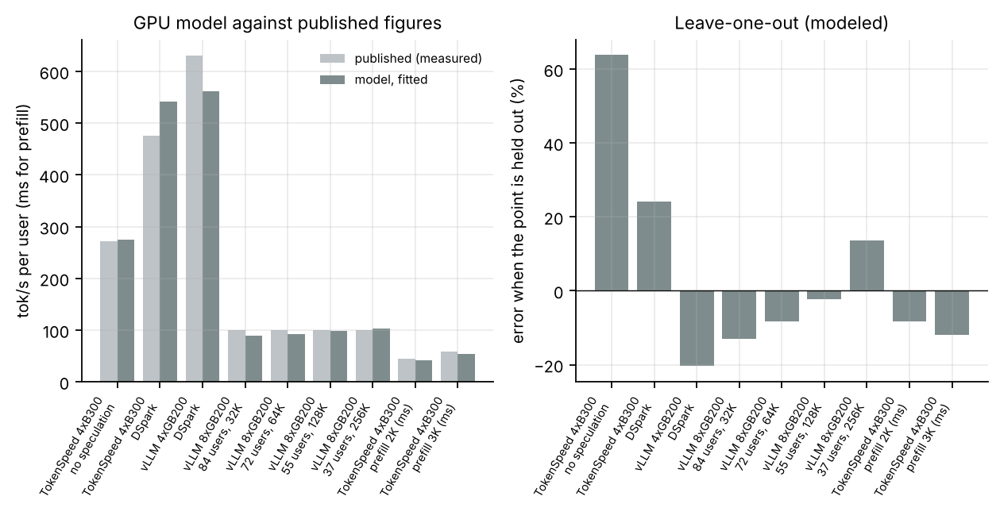
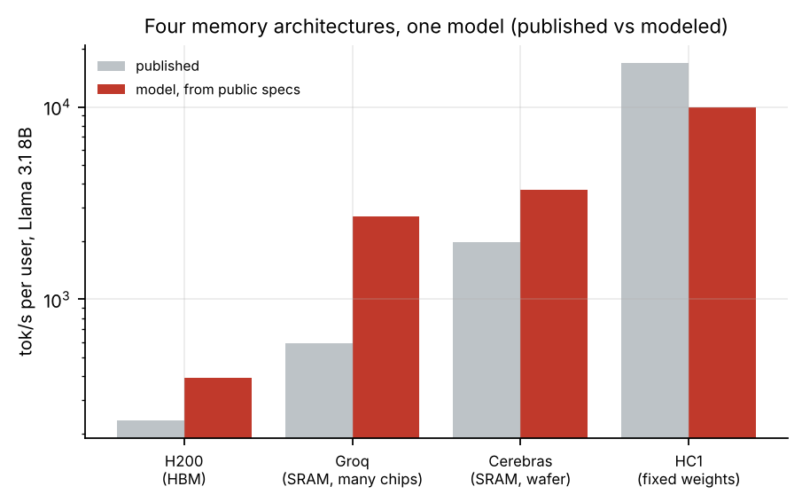

<!-- generated from docs/templates/06_simulator.md.j2 by experiments/render_docs.py; edit the template -->
# 06 · The simulator and its calibration

## What it is

An operation-level simulator. A model builder turns a checkpoint into the list of operations of one
decode step; an engine costs that list on a hardware description. Every platform sees the same list.

| piece | file | what it does |
|---|---|---|
| operation vocabulary | `sim/ops.py` | one record per operation: weight bytes, KV bytes, arithmetic, rows, kernel launches, dependencies |
| Inkling 2 builder | `sim/models/inkling2.py` | the step's operations from the checkpoint; parameter and byte counts equal the checkpoint's for every layer (tested) |
| scaled rungs | same | the same architecture at other sizes (hypothetical) |
| dense builder | `sim/models/dense.py` | Llama 3.1 8B, for the cross-architecture check |
| DeepSeek-V4.1 builder | `sim/models/dsv41/` | the previous study's model, unchanged |
| HBM engine | `sim/engine.py`, `sim/fast.py` | GPUs and HBM chips: memory streams, kernel launches, collectives |
| weight-stationary engine | `sim/stationary.py` | S and F: bank passes, lanes, tiles, hops, the shared attention tile, pipelining of requests across layers |
| energy, cost | `sim/energy.py`, `sim/cost.py`, `sim/stationary.py` | joules by cause; owned cost with NRE, yield, power |

The HBM engine is the DeepSeek-V4.1 study's, generalized so that models are builders. That study's
five result files still regenerate byte for byte (`tests/test_dsv41_unchanged.py`).

## The GPU model has four free constants

| constant | meaning | fitted | prior (DeepSeek study or assumption) | range across alternative readings |
|---|---|---|---|---|
| HBM efficiency | share of peak HBM bandwidth a weight stream gets | 0.802 | 0.838 | 0.66 to 1.00 |
| per-launch latency | wait per dependent kernel launch | 2.50 µs | 4.2 µs | 2.22 to 2.61 µs |
| attention efficiency | share of peak arithmetic the attention kernel reaches | 0.219 | 0.05 | 0.015 to 0.56 |
| per-row cost | extra time per row in flight | 0.055 µs | 0.3 µs | up to 0.06 µs |

Kernel launch counts are not fitted. They are counted in the serving engine's source: 17 launches per
NVFP4 layer, 16 per MXFP8 layer (tokenspeed-src, commit `a439df4`); 937 per speculative step in our operation graph for one request.

## Fit: 9 published figures, 4 constants

All published figures are **measured by their publishers**; we ran none of them.

| published figure | hardware, engine | batch | context | unit | published | model | error | with the prior constants |
|---|---|---|---|---|---|---|---|---|
| tokenspeed_b300_c1_target_only (tokenspeed-blog) | 4x B300, TokenSpeed | 1 | 94,000 | tok/s per user | 272 | 274 | +1% | -29% |
| tokenspeed_b300_c1_dspark (tokenspeed-blog) | 4x B300, TokenSpeed | 1 | 94,000 | tok/s per user | 476 | 541 | +14% | -14% |
| vllm_gb200_tp4_single_user (vllm-blog) | 4x GB200, vLLM | 1 | 8,192 | tok/s per user | 630 | 562 | -11% | -30% |
| vllm_gb200_tp8_32k (vllm-blog) | 8x GB200 (two 4-GPU nodes), vLLM | 84 | 32,768 | tok/s per user | 100 | 89.3 | -11% | -62% |
| vllm_gb200_tp8_64k (vllm-blog) | 8x GB200 (two 4-GPU nodes), vLLM | 72 | 65,536 | tok/s per user | 100 | 92.8 | -7% | -62% |
| vllm_gb200_tp8_128k (vllm-blog) | 8x GB200 (two 4-GPU nodes), vLLM | 55 | 131,072 | tok/s per user | 100 | 98.4 | -2% | -61% |
| vllm_gb200_tp8_256k (vllm-blog) | 8x GB200 (two 4-GPU nodes), vLLM | 37 | 262,144 | tok/s per user | 100 | 103 | +3% | -61% |
| tokenspeed_b300_prefill_2k (tokenspeed-src) | 4x B300, TokenSpeed | 1 | 1,024 | ms per forward | 44 | 41.5 | -6% | +120% |
| tokenspeed_b300_prefill_3k (tokenspeed-src) | 4x B300, TokenSpeed | 1 | 1,536 | ms per forward | 57.7 | 53.6 | -7% | +136% |

- RMS error 8.0%. With the DeepSeek study's constants and no fitting, errors
  were 14% to 30%.
- **Prefill is counted at the four throughput points.** That workload has about 3K new prompt tokens
  and 1,024 generated per turn. Each session's prefill is one forward on the same GPUs, once per
  turn, and takes 35% to 34% of the GPUs' time in the fit. Our first fit ignored it,
  which made the GPUs' decode look about four times worse at attention than it is; an adversarial
  review caught it ([05](05_limitations.md)).
- **Leave one out**: refit without each figure and predict it. Median error
  12.9%, largest 63.8% (the only figure without the draft model, which alone
  separates launch time from memory time). Predicted in advance for the median:
  20% (10 to 35).
- **Held out entirely**: TokenSpeed's two concurrency-8 figures, because the number of requests
  actually in flight at a step is not published.
  tokenspeed_b300_c8_dspark: published 325; the model gives 203 with 8 in flight and 541 with 1, so the published figure is inside the range.
  tokenspeed_b300_c8_target_only: published 195; the model gives 152 with 8 in flight and 274 with 1, so the published figure is inside the range.

### A check the model fails

The engine's source comments give the time of one full-attention kernel on B300. This was not in the fit.

| context | published kernel time | model | error |
|---|---|---|---|
| 8,192 keys | 10.3 µs | 4.1 µs | -61% |
| 32,768 keys | 14.6 µs | 7.4 µs | -49% |
| 131,072 keys | 36.7 µs | 20.6 µs | -44% |

The model's attention kernel is faster than the engine's own timing at every context. So the fitted
GPU is, if anything, better at attention than the real one: the comparison at long context and high
batch leans towards the GPU. Putting these timings in the fit pins the HBM efficiency at its bound
and worsens every speed point, so they stay a held-out check. The sweep covers the gap: "GPU
attention kernel efficiency, 0.5x to 1.8x".

### Alternative readings of the published figures

Some published conditions are ambiguous. Each alternative reading was refitted:

| reading | HBM efficiency | per-launch | attention efficiency | RMS error |
|---|---|---|---|---|
| as fitted | 0.80 | 2.50 µs | 0.219 | 8.0% |
| TokenSpeed acceptance 3.0 | 0.93 | 2.61 µs | 0.197 | 6.0% |
| TokenSpeed acceptance 4.0 | 0.66 | 2.22 µs | 0.387 | 10.6% |
| vLLM single-user context 1K | 0.80 | 2.50 µs | 0.220 | 8.0% |
| vLLM single-user context 64K | 0.82 | 2.54 µs | 0.209 | 8.2% |
| without the two prefill points | 0.79 | 2.51 µs | 0.152 | 6.3% |
| prefill forwards carried a 32K cached prefix | 0.72 | 2.31 µs | 0.190 | 6.2% |
| prefill takes none of the GPUs' time at the throughput points (our first reading) | 0.85 | 2.60 µs | 0.052 | 7.8% |
| prefill is a fixed 30% of GPU time at the throughput points | 0.82 | 2.54 µs | 0.141 | 6.3% |
| 2K new prompt tokens per turn | 0.80 | 2.49 µs | 0.144 | 6.2% |
| 4K new prompt tokens per turn | 0.74 | 2.31 µs | 0.557 | 10.0% |
| throughput sessions 80% in flight | 0.80 | 2.51 µs | 0.131 | 5.6% |
| single-user decode points only | 1.00 | 2.55 µs | 0.015 | 2.1% |
| vLLM points only | 1.00 | 2.54 µs | 0.146 | 0.2% |

The attention efficiency is the constant these readings move most: it follows how much prefill is
assumed to sit on the GPUs. It sets the GPUs' throughput at high batch, and so the energy and cost
comparison at the best interactive point.

## The cross-architecture check: Llama 3.1 8B on four machines

Llama 3.1 8B is the one model with published speeds on a GPU, two SRAM machines and a fixed-weight
chip. We ran the simulator on each from public specifications only, with no fitting.

| machine | memory | published tok/s | simulator | error | within 30% |
|---|---|---|---|---|---|
| NVIDIA H200, one GPU (HBM) | 141 GB HBM3e at 4.8 TB/s | 235 (vendor; nim-bench) | 389 | +65% | no |
| Cerebras WSE-3 (SRAM, one wafer) | 44 GB SRAM at 21 PB/s on one 46,225 mm2 wafer; 5 nm; 16-bit weights | 1,981 (relayed; taalas-chart) | 3,694 | +86% | no |
| Groq LPU (SRAM, many chips) | 230 MB SRAM per chip at up to 80 TB/s; 14 nm; chips per model not published for this model | 594 (relayed; taalas-chart) | 2,693 | +353% | no |
| Taalas HC1 (fixed weights, one die) | 8B parameters of 3 and 6 bits in mask-programmed storage on one 815 mm2 N6 die | 16,960 (vendor; taalas-chart) | 9,960 | -41% | no |

**0 of 4 within 30%.** We predicted 2
(1 to 3). Public specifications are not enough to predict
these machines, and the direction of each miss is informative:

- **GPU**: the simulator is +65% fast. The vendor's own
  pair of figures (FP8 235 and BF16 140 tok/s)
  implies an HBM efficiency of 0.58 and
  1.49 ms of fixed time per token on that stack, against
  0.80 and 0.57 ms carried over from the
  Blackwell engines. A general-purpose serving stack on an older GPU is slower than a tuned engine.
- **Both SRAM machines run well below their memory bound.** The wafer-scale machine reaches
  54% of the speed its memory bandwidth allows; the
  many-chip machine 22%. Memory bandwidth does not set their
  speed. Something per operation does.
- **The fixed-weight chip is faster than this study's own timing constants predict**
  (-41% against the vendor's figure,
  -30% against an independent probe of
  14,150 tok/s).

### What we took from it

The check failed as a prediction and we used it as a measurement. Dividing each machine's published
time per token by the 129 weight operations a token needs gives a time per weight operation,
with nothing subtracted:

| machine | time per weight operation | used for |
|---|---|---|
| wafer-scale SRAM | 3.91 µs | **S**, central value: its own bank pass is inside this figure. A pays the part beyond S's pass |
| many-chip SRAM | 13.1 µs | S, pessimistic end of the sweep |
| fixed-weight die | 0.55 µs, from the independently probed speed | **F** |

Our first pass gave S an assumed 0.3 µs beyond its pass and came out near 8,000 tok/s per user, about
15x the GPUs and above our prior. A second pass subtracted the published machine's memory pass,
computed from its stated bandwidth, and added S's own shorter one; a reviewer pointed out that the
subtraction rested on a marketing figure. S now takes the published machine's whole time per
operation: 2,960 tok/s. The inference from one model on someone else's machine to another model
on ours is the weakest link in the speed result, and it is swept across the range in the table.

## Uncertain inputs

30 inputs, each with a low and a high value. The Monte Carlo draws each
independently between its bounds.

| input | low | high | why |
|---|---|---|---|
| acceptance length | 3 | 4 | published 3.3-3.5; wider to cover other workloads |
| routing locality | 0 | 0.5 | no Inkling routing traces; neighbouring tokens share experts in open models |
| routing skew (Zipf) | 0 | 1.1 | uniform to 'top 20% of experts get 80%' |
| GPU power, share of TDP | 0.75x central | 1.25x central | measured on H100, carried to B300 |
| GPU price | 45,000 | 76,000 | reseller range per GPU with networking |
| GPU attention kernel efficiency | 0.5x central | 1.8x central | 0.5x matches the engine's own kernel timings; 1.8x covers the fit's alternative readings |
| GPU per-launch latency | 0.92x central | 1.05x central | range across the fit's alternative readings |
| GPU HBM efficiency | 0.66 | 0.93 | range across the fit's alternative readings |
| S per-operation latency | 1.2 µs | 13.1 µs | whole time per weight operation: S's own bank pass plus half again, to a published many-chip SRAM system's; central is a published wafer-scale machine's (3.9 us) |
| S lane clock | 0.9x central | 1.3x central | timing as closed on the open kit with no process speed-up, to the best period reached with a full 7-to-4 nm speed-up |
| S bank depth (rows per pass) | 256 | 1,024 | design choice: deeper banks are denser and slower |
| S hop between tiles | 0.1 µs | 2 µs | no public latency for a link of this kind |
| S hop inside a tile | 0.02 µs | 0.5 µs | standard under 2 ns; buffering unknown |
| S KV memory bandwidth | 0.5x central | 2x central | half to twice MDA-1's HBM stack rate |
| S attention tile rate | 0.5x central | 2x central | sized by assumption; central equals what four B300 reach in the fit |
| S SRAM density | 0.3 | 0.6 | macro-level to die-level published densities |
| S multiplier area | 0.5x central | 2x central | synthesis scaled across nodes |
| S SRAM read energy | 0.05 | 0.5 | full-row scan estimate to MDA-1's value |
| S arithmetic energy | 0.2x central | 2x central | measured 5 nm 4-bit chip is far below the assumed value |
| S SRAM leakage | 0.22 | 4.4 | measured at 25 C, times 1 to 20 for temperature |
| S retention factor | 0.05 | 0.31 | published range |
| S logic static power per die | 1 | 15 | assumption |
| S idle link power per tile | 0 | 36 | no public figure |
| S wafer price | 16,000 | 21,300 | analyst band |
| S package and test per die | 400 | 1,250 | area-scaled substrate only, to the HBM chip's own per-die rate |
| S boards, power, cooling per die | 150 | 1,000 | assumption |
| S lifetime (years) | 2 | 5 | a chip laid out for one architecture may be retired before a GPU is, or serve its successors longer |
| S seller's gross margin | 0 | 0.5 | costed to its owner in the central case; GPUs are at street price |
| S design NRE | 30,000,000 | 436,000,000 | a fixed-weight start-up's total to the IBS 5 nm estimate |
| fleet demand (tokens per day) | 500,000,000,000 | 20,000,000,000,000 | assumption: design cost is spread over the systems this demand needs |

Rows without a unit are in the unit of `configs/hw/*.yaml` (mm² per MiB, pJ per bit, W per GB, W,
USD, dies).

## Checks that run with `make test`

- Parameter and byte counts from the builder equal the checkpoint's, layer by layer; the total equals
  the Hub's 594,050,672,720.
- KV bytes per token equal the engines' published figures.
- The pre-registered predictions have not been edited (hash).
- The DeepSeek-V4.1 results regenerate byte for byte.
- The GPU fit reproduces from the committed inputs.
- The generated docs match the results.
- The RTL block's vectors and batch-invariance test ([07](07_silicon.md)).
