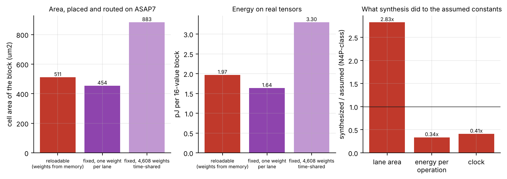

<!-- generated from docs/templates/07_silicon.md.j2 by experiments/render_docs.py; edit the template -->
# 07 · One block in silicon: the NVFP4 dot product

The system model needs three numbers for a multiplier lane: its area, its energy and its clock. For
the first six phases they were assumptions. This page replaces them for the NVFP4 lane, which serves
71% of the weight bytes.

One block was built: the inner loop of an expert's matrix product in layers 0 to 39, where both the
weights and the activations are NVFP4 (4-bit codes with a shared scale per 16 values). It was
generated as SystemVerilog from the model's config, checked bit for bit against a reference on real
expert weights, and placed and routed on an open 7 nm predictive kit (ASAP7). The full engineering
report, with every command, is [`rtl/nvfp4/REPORT.md`](../rtl/nvfp4/REPORT.md); every number is in
[`results/silicon.json`](../results/silicon.json).

**This is one block, not a chip.** No memory, no clock distribution beyond the block, no floorplan.

## Two variants

| | reloadable (`nvfp4_dot`) | fixed (`nvfp4_dot_const`) |
|---|---|---|
| weights | arrive on ports from a memory, 16 at a time | constants taken from a real expert row |
| used for | S | F, as the comparison |

## Verification

| check | result |
|---|---|
| vectors compared against the bit-exact reference | 1,589,011 (1,165,348 reloadable, 423,663 fixed), **0 mismatches** |
| what the vectors are | real rows of a real expert (layer 0, expert 0, and row samples from other layers) against activations derived from the model's own embeddings, plus directed edge cases: zeros, signed zero, largest and smallest scales, cancellation, rounding ties, overflow |
| simulators | Verilator 5.020 2024-01-01 rev (Debian 5.020-1); second simulator: Icarus Verilog version 12.0 (stable) () |
| reference against PyTorch on a whole real expert | pass (torch 2.15.0+cpu) |
| stored format | checked against the checkpoint bytes and against a serving engine's own quantizer run from source: pass |
| batch invariance | 48 probe requests, each placed in 30 different batch sizes, positions and idle patterns: 1 distinct result per probe (pass) |
| placed-and-routed netlist against the reference | reloadable: bit-exact; fixed: bit-exact |

Batch invariance matters for this model's customers: a request's output must not depend on what else
is in the batch. In this block it holds by construction (each row has its own accumulator and a fixed
order of additions), and the test confirms it.

## Placed and routed (measured in an open flow)

asap7sc7p5t RVT standard cells, NLDM, TT corner (0.70 V, 25 C); ORFS CORNER=TC. Both variants at a 1,800 ps clock
(556 MHz), one 16-value block per clock. Power from gate-level activity on real tensors.

| | reloadable | fixed, one whole row time-shared through the lanes | reloadable / fixed |
|---|---|---|---|
| cell area | 511.1 µm² | 882.8 µm² | 0.58 |
| cells (flip-flops) | 4,548 (273) | 8,234 (279) | |
| setup / hold slack | 23.3 / 38.1 ps | 21.8 / 35.7 ps | |
| dynamic power | 1.092 mW | 1.831 mW | 0.60 |
| leakage | 0.41 µW | 0.72 µW | |
| energy per 16-value block | 1.97 pJ | 3.30 pJ | 0.60 |
| energy per multiply-accumulate | 0.123 pJ | 0.206 pJ | |
| area per multiplier lane | 31.9 µm² | 55.2 µm² | |
| weights held in the module | none (they come from memory) | 4,608 hard-wired, 0.19 µm² each including the datapath | |

The best clock period reached was 1,617 ps. The critical path in
both variants is the single-cycle 32-bit floating-point accumulate.

## What fixing the weights buys depends on how they are used

We predicted a fixed-weight datapath would be 1.8x smaller and use
2x less energy. The synthesis says it depends:

| how the fixed weights reach the lanes | reloadable / fixed, area | reloadable / fixed, energy |
|---|---|---|
| **a lane always sees the same weight** (the same 16 weights in every block of the row, so the constants fold into the multipliers) | **1.13** (1.12 to 1.13, n=2) | **1.12** (1.11 to 1.13) |
| **a whole row of 4,608 weights time-shared through 16 lanes** (the weights become a table in logic) | 0.58 | 0.60 |

- When every lane has its own fixed weight, the block shrinks by 1.13x and
  saves 1.12x in energy. The multipliers fold away; the adder tree
  and the 32-bit accumulator remain, and they are most of the block. That is the comparison the
  predictions meant: area landed below the predicted range, energy below it.
  (A first version of this test used rows one block long. Synthesis then removed the accumulator as
  well and showed a larger saving; that result is kept in the JSON with a warning and is not used.)
- When the fixed weights are time-shared, the fixed module is *larger* than the reloadable one,
  because it contains its weights and the reloadable one does not. As storage it is dense:
  0.19 µm² per hard-wired weight in standard cells, datapath included.
  For scale, the one shipped fixed-weight chip holds 8B weights on 815 mm², about
  0.10 µm² per weight on an older process with custom cells (taalas-hc1).

So fixing a lane's weight saves little in that lane. The reloadable design is still larger, for two
reasons: an SRAM bit is larger than a mask-programmed one, and S has a multiplier lane on every bank,
which is 32% of its silicon, while the fixed design's density figure comes from one shipped chip
with its arithmetic folded in. How much of the difference is reloadability and how much is that chip's
design cannot be separated from public data.

The middle bar (one weight per lane) was measured on its own one-block workload; on that same workload
the reloadable block uses 1.83 pJ, which is where the
1.12 in the table comes from.

## From the open kit to an N4P-class process

ASAP7 is a predictive kit; its numbers are reliable relative to one another, not as predictions of a
foundry process. Three factors carry them over, and all three are in the uncertainty sweep.

| | on ASAP7 | factor | N4P-class value used | assumed before synthesis | new / old |
|---|---|---|---|---|---|
| area per NVFP4 lane | 31.9 µm² of cells | × 0.69 (cell pitches; asap7-scaling), ÷ 0.65 placement utilization (assumption) | 33.9 µm² | 12 µm² | 2.8x |
| energy per NVFP4 operation | 0.061 pJ | × 0.82 (N5 to N4P; n4p) | 0.050 pJ | 0.15 pJ | 0.34x |
| clock | 556 MHz, timing closed | × 1.11 (N5 to N4P; n4p) | 617 MHz | 1,500 MHz | 0.41x |

Only the published N5-to-N4P step is applied to speed and energy; ASAP7 is otherwise treated as
N5-class, which is conservative. Only the NVFP4 lane was built: the MXFP8 and BF16 lanes take the
same area correction and keep their assumed energy.

## What it changed

| S against the GPUs | with the assumed lane | with the synthesized lane |
|---|---|---|
| time for one pass over a weight bank | 0.34 µs | 0.83 µs |
| multiplier lanes | 47,500 mm² | 134,300 mm² |
| dies | 384 | 521 |
| system cost | $1,141,000 | $1,382,000 |
| speed for one user | 4.1x | 4.1x |
| tokens per joule, one user | 3.8x | 3.0x |
| tokens per joule, best point | 3.7x | 4.4x |
| cost per token, best point | 2.2x | 1.8x |

The lane is larger and slower-clocked than we assumed and uses less energy. The machine grew by
137 dies and its cost gain fell from 2.2x to 1.8x. Speed barely moved: S's
time per weight operation is taken whole from a published machine, and its own bank pass sits
inside that figure either way. Every result in [04](04_results.md) uses the synthesized values.

We did not re-tune the design afterwards. A lane this size argues for deeper weight banks or for
sharing lanes between experts, since one request touches about 60 of
384 experts per layer per step and the other lanes sit idle. Either
would cut the die count and is the obvious next step; neither is in these results.

## For context

A published NVFP4 multiply-accumulate block at 28 nm reports 21.5 pJ
per 16-value block at 524 MHz in 0.024 mm²
(nvfp4-mac-28nm). Ours on ASAP7: 1.97 pJ and 0.00051 mm² of
cells. Different node, library, design and method; it shows the two are in the range process scaling
would explain, nothing more.

## Not done

- No memory was built. The reloadable lane's weights come from an SRAM that is costed from published
  macros, not synthesized.
- One block and one precision. The MXFP8 lane, the BF16 attention datapath, the router's top-8 select
  (carried over from the previous study) and the softmax were not built here.
- No pipelining of the accumulator. A carry-save accumulate would clock faster; it has to stay
  bit-exact with the serving engines' arithmetic, which we did not attempt.
- One corner (typical, 0.70 V, 25 °C). No signoff, no variation, no test logic.
- ASAP7 only. Nothing was run on a foundry kit.
- Power comes from gate-level activity without delays, so glitches are not counted and absolute power
  is optimistic. The sweep covers the arithmetic energy from 0.2x to 2x.
- The activations are realistic but not from a forward pass: real embedding rows through the real
  layer-0 norm, and the outputs of the real first matrix. One expert was fetched whole.
- One placement seed per design. Timing closes at 1,800 ps and misses at 1,600 ps.

## Reproduce

`make test` runs a short version of the verification if Icarus Verilog is installed. The full run
(vectors, second simulator, PyTorch check, place and route in the OpenROAD flow's Docker image) is
`python rtl/nvfp4/run_all.py`; see section 11 of the [report](../rtl/nvfp4/REPORT.md).
